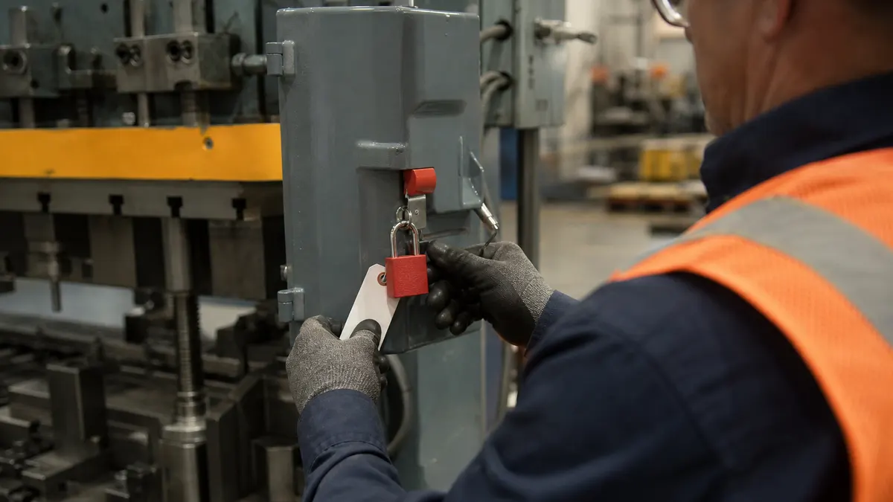

> **Key Takeaways**
>
> - An ISO 45001 incident investigation procedure is a written, repeatable method for reacting to an event, finding its causes, and proving the fix worked.
> - Clause 10.2 of ISO 45001:2018 expects timely reaction, investigation with worker participation, root cause evaluation, corrective action, and a review of whether that action was effective.
> - Near misses belong in the procedure as much as injuries do, because they show the same weakness before anyone is hurt.
> - The investigation is only finished when the corrective action is verified and the OH&S risk assessments and controls reflect what was learned.

**Illustrative example:** What should happen in the first hour after a press operator is hurt, a forklift clips a rack, or a worker reports a near miss on the night shift? If the answer depends on who happens to be on site, the plant does not yet have a working ISO 45001 incident investigation procedure. This checklist walks through nine points that turn an ad hoc reaction into a repeatable method, written for plant managers and quality leads at Ontario manufacturers.

## When to Start an ISO 45001 Incident Investigation

The procedure should trigger on more than injuries. ISO 45001:2018 uses the word "incident" for events that result in harm and for events that could have, so a near miss, a damaged guard, a chemical release that hurt no one, and a reported case of work-related ill health all belong in scope.

Write the triggers down in plain terms. A concise list supervisors can use without interpretation may be more practical than a definition that needs interpreting.

- **Injury or ill health:** any event where a worker, contractor or visitor is hurt or becomes unwell because of work.
- **Near miss:** any event that could have caused harm, such as a dropped load, a bypassed interlock or a spill near a walkway.
- **Property or process event:** damage to equipment or a failed control that exposed people to a hazard, even if no one was present.
- **Repeat condition:** the same unsafe condition reported a second or third time, which signals that an earlier action did not hold.

The [ISO 45001 OH&S management](/services/iso-45001) pages explain how this procedure fits inside the wider system. For the full picture of what a registrar looks for, the [ISO 45001 requirements checklist for manufacturing](/blog/iso-45001-requirements-checklist-for-manufacturing-10-areas-to-verify) covers ten areas to verify.

## 1. Make the Scene Safe and Provide Immediate Support

Nothing else starts until people are safe. Stop the equipment, apply first aid, call emergency services where needed, and keep other workers out of the area. The procedure should name who has the authority to stop a line without waiting for approval.

Preserve the scene as far as safety allows. Lockout of the machine, photographs before anything is moved, and a note of what was running at the time all protect the evidence. Moving a damaged part to clear the floor is understandable, but it removes the proof that the investigation will need later.

## 2. Report and Record the Incident Promptly

The reporting route should be short and available on every shift. A paper form at the supervisor's station, a QR code on the machine, or a verbal report to the shift lead that gets logged within the shift all work, as long as the person reporting does not fear blame.

Record the basics while memories are fresh: date, time, location, people involved, what happened, and what was done at once. Ontario employers also carry legal reporting duties for certain serious events under the [Ontario Occupational Health and Safety Act](https://www.ontario.ca/laws/statute/90o01), so the procedure should point to the person who decides whether a regulator, the joint health and safety committee or the workers' compensation board must be notified.

> **Important:** A procedure that records only injuries misses the cheapest learning available. A near-miss investigation may require fewer resources than an injury investigation, and its causes may be similar.

## 3. Define the Investigation Scope and Team

Not every event needs the same depth. A minor first-aid case may need a supervisor and a short review, while a serious injury or a high-potential near miss deserves a team and a formal report. Set the thresholds in advance so that the decision is not made under pressure.

A useful team usually includes a supervisor who knows the work, a worker who does the task, someone with authority to change the process, and a safety or quality representative who keeps the method consistent. The investigator should not be the person whose area is under review.

This is where worker involvement becomes a requirement and not a courtesy. Clause 5.4 of ISO 45001:2018 expects non-managerial workers to take part in incident investigation, and the guide to [meeting ISO 45001 worker participation requirements](/blog/how-to-meet-iso-45001-worker-participation-requirements-in-6-steps) shows how to set that up in practice.

## 4. Gather Evidence and Interview Those Involved

Collect evidence from four sources: the physical scene, the equipment and its records, the written procedures, and the people. Maintenance logs, the risk assessment for the task, training records and the shift schedule often explain more than the scene itself.

Interviews go best when they are held promptly, one person at a time, and open with questions about the task instead of the mistake. Ask what the worker was trying to do, what was normal on that shift, and what made the job harder than it should be.

- **Ask about the work as done:** the way a task is performed on the floor often differs from the written instruction, and that gap is a finding in itself.
- **Separate facts from opinions:** record what was seen and measured, and mark conclusions as conclusions.
- **Include witnesses and the injured worker** where they are able, and give them a chance to correct the record afterward.

## 5. Identify Immediate and Root Causes

The immediate cause is what directly produced the event, such as a hand entering the pinch point. The root causes are the conditions that allowed it: a guard that was awkward to reset, a production target that rewarded bypassing it, or training that never covered the jam-clearing task.

The standard does not prescribe a method. Common choices are the five whys, a cause-and-effect diagram, and fault tree analysis, and the procedure should say which one applies to which severity. Whatever the method, the test is whether the cause points to something the plant can change, not to a person who should have been more careful.

> **Key Consideration:** If the root cause reads "operator error" or "failed to follow procedure," keep asking why. The standard expects the evaluation to look at the management system, not only at individual behavior.

## 6. Check for Similar Risks Elsewhere

One incident is evidence about a type of hazard, not only about one machine. After the cause is understood, ask where else the same condition could exist: the identical press on another line, the same task on the other shift, or a similar chemical at another station.

This step connects the investigation to hazard identification and risk assessment under clause 6.1.2 of ISO 45001:2018. The Canadian Centre for Occupational Health and Safety publishes plain-language guidance on [hazard identification](https://www.ccohs.ca/oshanswers/hsprograms/hazard/hazard_identification.html) that helps when the team needs a method for walking the plant.

## 7. Assign Corrective Actions and Owners

Each root cause needs an action, an owner and a due date. Actions follow a sensible order: remove the hazard, then engineer controls, then administrative controls, and personal protective equipment last. Retraining alone is a weak action when the real cause is a poorly designed task.

Keep actions specific enough to be checked. "Improve guarding" cannot be verified; "fit an interlocked guard to the rear access of the press and update the lockout procedure" can. Where an action needs time, put an interim control in place and record it.

- **Containment:** the immediate step that keeps people safe until the permanent fix is in place.
- **Corrective action:** the permanent change aimed at the root cause.
- **Preventive follow-up:** the check of other lines, tasks or sites identified in point 6.

## 8. Verify Actions Are Effective

Clause 10.2 of ISO 45001:2018 asks the organization to review the effectiveness of the actions taken. Completion of a task is not the same as the problem going away.

Set a verification date when the action is assigned. At that date, someone other than the action owner checks the floor: Is the guard in place and in use? Has the near-miss pattern on that line changed? Do operators describe the new method the same way the procedure does?

> **Did You Know?** ISO 45001:2018 requires documented information as evidence of the nature of the incidents or nonconformities, the actions taken, and the results of those actions, including their effectiveness.

## 9. Share Findings and Update OH&S Controls

An investigation that stays in the report does not protect anyone. Share the findings with the workers who do the affected task, with the joint health and safety committee, and with management. The Ontario government's guide to [health and safety committees and representatives](https://www.ontario.ca/page/guide-health-and-safety-committees-and-representatives) describes the committee's role in Ontario workplaces.

Then update the controls the investigation touched: the risk assessment, the work instruction, the training matrix and the lockout procedure. Findings should also reach the management review, where trends across incidents show whether the system as a whole is improving.

## Quick-Reference Summary

Use this table as the one-page version of the procedure on a supervisor's board or in the onboarding pack.

| Point | Action | Evidence to keep |
|---|---|---|
| 1 | Make the scene safe | Time of stop, first-aid record |
| 2 | Report and record | Incident report, notification decision |
| 3 | Scope and team | Severity rating, team list |
| 4 | Gather evidence | Photos, interviews, task records |
| 5 | Find root causes | Method used, cause statements |
| 6 | Check elsewhere | Extent-of-condition review |
| 7 | Assign actions | Action log with owners and dates |
| 8 | Verify effectiveness | Check date, result, verifier |
| 9 | Share and update | Updated risk assessment, meeting notes |

## Frequently Asked Questions

### What incidents should an ISO 45001 investigation cover?

The procedure should cover injuries, cases of work-related ill health, and near misses. ISO 45001:2018 treats an incident as an event arising from work that could or does result in harm, so events with no injury still count.

### How soon should a manufacturer investigate a workplace incident?

Immediately for safety, and as soon as practical for the investigation itself. The standard asks for a timely reaction, and evidence and memories fade quickly, so many plants begin interviews and photography within the same shift and set a short deadline for the first report.

### Who should participate in an ISO 45001 incident investigation?

A supervisor, a worker who knows the task, someone with authority to change the process, and a safety or quality representative make a workable core team. The worker involvement requirement in clause 5.4 means non-managerial workers take part, and the joint health and safety committee may also have a role.

### How does root cause analysis support corrective action?

Corrective action aimed at the immediate cause treats the symptom and lets the event return. Root cause analysis finds the condition behind the event, so the action changes the system and the verification step can show that it worked.

### What records should a manufacturer retain after an incident investigation?

Keep the incident report, evidence and interview notes, the cause analysis, the action log with owners and dates, the verification result, and any updated risk assessments. Clause 7.5 of ISO 45001:2018 governs how documented information is controlled, and the retention period should be set in the procedure.

Keeping reports, actions, verification dates and updated risk assessments linked across shifts and sites is the part that slips when it lives in spreadsheets and email. ISO Certification Consultants' compliance management software, including its [Improvements module](/solutions/nonconformance-capa/), keeps each corrective action tied to its owner and due date, and you can [book a demo](/contact/) to see how.
