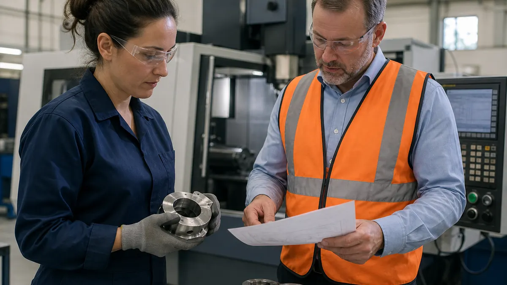
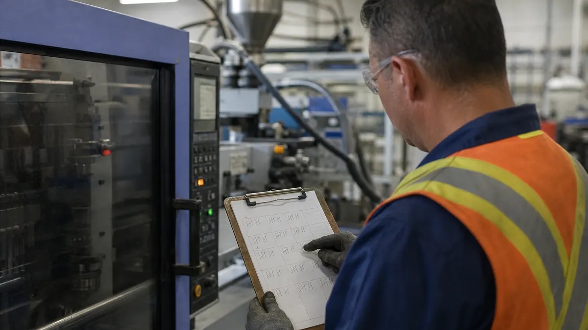

> **Key Takeaways**
>
> - A management review is a planned meeting where top management judges whether the quality system is suitable, adequate, effective and aligned with the direction of the business.
> - The agenda should follow the inputs the standard lists, so nothing a registrar expects to see is left out.
> - The review must retain documented information as evidence of its results; assigning owners and due dates can support follow-up.
> - Prepare data before the meeting; the meeting itself is for decisions.

**Illustrative example:** A plant manager opens the folder before a surveillance audit and finds a prior management review record with no documented decisions. An inspection station that had been considered was never added, and the record does not explain whether leadership declined it. An ISO 9001:2026 management review meeting agenda built around decisions can help prevent that, because every item on it ends in something leadership either approves, rejects or schedules as part of [the six-stage certification process](/process).

The requirement sits in clause 9.3 of ISO 9001:2015. The current edition, [ISO 9001:2026](https://www.iso.org/standard/9001), was published in September 2026, and many certified organizations remain on the 2015 edition during the three-year transition, so the clause references below name that edition. For background on the standard itself, [ISO's own explanation of ISO 9001](https://www.iso.org/home/insights-news/resources/iso-9001-explained.html) is a good starting point.

## Step 1: Define the Meeting Purpose and Participants

**What to do.** Write one sentence that states why the meeting exists: top management reviews the quality management system at planned intervals to confirm it remains suitable, adequate and effective and is aligned with the strategic direction of the organization. Put that sentence at the top of the agenda. Then decide who must be in the room.

The standard says "planned intervals" and does not set a fixed number of months. Pick a rhythm you can keep, use the [ISO 9001 Certification Timeline for Small Manufacturers: Stages, Delays, and Planning](/blog/iso-9001-certification-timeline-for-small-manufacturers-stages-delays) to plan around audit milestones, put the dates in the calendar for the whole year, and treat them as fixed.

**What you need.** Top management must take part, because the standard assigns the review to them. For a regional fabricator in the [Manufacturing industry](/industries/manufacturing), that usually means the owner or general manager, the plant manager, and the quality manager, who normally prepares the material. Add the people who own the topics being reviewed:

- **Operations or production leadership** explains process performance and delivery results, since they live with the numbers every day.
- **Purchasing or supply chain** speaks to the performance of external providers, which is one of the required inputs.
- **Human resources or the training lead** covers competence and resource adequacy when those topics are on the table.

**The common mistake.** Holding the review with only the quality manager present. If the person who can approve a new inspection station or a hiring request is absent, the meeting produces observations instead of decisions, and a registrar, familiar with [Standards Council of Canada: about accreditation](https://scc-ccn.ca/accreditation/about-accreditation), will notice that the "top management" in the minutes never changes.

## Step 2: Gather Required ISO 9001 Management Review Inputs

**What to do.** Build the agenda from the list of inputs in clause 9.3.2 of ISO 9001:2015. Each input becomes a line item with a named presenter. This protects you in an audit, because the registrar can match the agenda to the standard in a few minutes.

> **Important:** Clause 9.3.2 of ISO 9001:2015 expects the review to consider the status of actions from earlier reviews, changes in external and internal issues, performance information, the adequacy of resources, the effectiveness of actions on risks and opportunities, and opportunities for improvement.

The performance information is the largest block. It covers customer satisfaction and feedback, how far quality objectives have been met, process performance and conformity of products and services, nonconformities and corrective actions, monitoring and measurement results, audit results, and the performance of external providers. Give each of those a slot, even if the slot is five minutes.

**What you need.** A short pre-read, circulated several days before the meeting, with one page per input. Reading it aloud in the room wastes the time that should go to discussion.

| Input | Typical source | Owner |
|---|---|---|
| Actions from the last review | Previous minutes | Quality manager |
| Customer feedback | Complaints, returns, scorecards | Sales or customer service |
| Process performance | Scrap, rework, on-time delivery | Operations |
| Audit results | Internal and external audit reports | Quality manager |
| External provider performance | Supplier scorecards | Purchasing |

**The common mistake.** Treating the input list as a menu. Skipping a required input because the data is awkward to collect leaves a visible gap, and that awkward topic is often the one that most needs attention.

## Step 3: Review Quality Objectives and Performance Trends

**What to do.** Show each quality objective against its target and then show the trend, not just the latest number. One bad month tells you little; six months of drifting delivery performance tells you a process is losing control. The leadership team should ask the same three questions for each objective: whether the target was met, what drove the result, and what decision follows. If the answer to the third question is "nothing", challenge whether the objective is still the right one.

**Illustrative example:** If scrap on one press line has been trending upward, leadership might approve a trial of tighter first-piece checks on that line. If an on-time delivery target is consistently met with little effort, leadership might raise it or replace it with a measure that exposes a real weakness, such as quote-to-ship lead time.

**What you need.** Trend charts with the target line drawn on them, and a one-line explanation from the process owner for any result that moved more than expected.

> **Key Consideration:** Use the same measures from one review to the next. Changing the metrics every quarter makes trends impossible to see and invites the suspicion that unflattering numbers were dropped.

**The common mistake.** Presenting averages that hide a problem. A plant-wide on-time delivery figure can look healthy while one product family is consistently late. Break the data down by line, product family or customer where the variation matters, and note where the objectives were set in line with what customers require. The [ISO 9001 quality management service](/services/iso-9001) page explains how objectives connect to the rest of the system.

## Step 4: Assess Risks, Opportunities, and Resource Needs

**What to do.** Review whether the actions taken to address risks and opportunities worked. This is a specific input in clause 9.3.2 of ISO 9001:2015, and it is where the meeting moves from looking back to looking ahead. For each significant risk on the register, ask whether the control is holding, whether the risk has grown or shrunk, and whether a new risk has appeared.

**What you need.** The current risk and opportunity register, the changes in external and internal issues since the last review, and a plain statement from each department about whether it has the people, equipment, space and information to do the job.

**Illustrative example:** A machine shop that has added a second shift might notice during the review that final inspection only has one trained inspector, and that the inspector's absence delayed shipments. The risk register had no entry for it. The review adds the risk, assigns a training action, and asks for a resource decision on a second inspector.

The resource discussion is the part many shops rush. Clause 9.3.3 of ISO 9001:2015 expects outputs that include resource needs, so the agenda should leave time for leadership to say yes, no, or "not until next quarter" to specific requests.

**The common mistake.** Treating the risk register as a document that is reviewed only when an audit approaches. If the register has not changed in a year, either the business has stood still or nobody is looking at it.

## Step 5: Record Decisions and Assign Actions

**What to do.** Capture every decision as it is made, in words that someone who was not in the room could act on. For each action, write what will be done, who owns it, and when it is due. Clause 9.3.3 of ISO 9001:2015 describes the outputs as decisions and actions related to opportunities for improvement, any need for changes to the quality system, and resource needs.

When a topic needs more discussion than the meeting allows, assign an action to bring a proposal to the next review rather than letting the topic fade.

**What you need.** A minutes template that mirrors the agenda, with a decisions and actions block under every input. The standard requires documented information as evidence of the results of management reviews, so the minutes are not optional paperwork. The template should record:

- **Attendees and date**, so the record shows top management was present.
- **Each input covered**, with a brief note on what was reported.
- **Decisions made**, written as outcomes rather than discussion summaries.
- **Actions with owner and due date**, so follow-up is possible.

**The common mistake.** Writing minutes weeks later from memory. Details are lost, owners are guessed, and the record reads as an afterthought. Draft the minutes during the meeting and send them out within a few days.

## Step 6: Follow Up and Improve the Next Review

**What to do.** Track every action to closure between meetings and open the next review with their status. This is the first input on the list for a reason: it proves the cycle works. An action that is overdue should be visible to leadership long before the next scheduled meeting.

After each review, spend ten minutes asking whether the meeting itself worked: were the pre-reads on time, and did missing data stall a topic?

**What you need.** One place where actions live that the whole team can see, with due dates and owners, and a reminder habit for the quality manager. The [Audits module](/solutions/audits-management-review/) in ISO Certification Consultants' compliance management software is built around audits and management review, and the [QMS platform overview](/platform) shows how the pieces fit together.

> **Did You Know?** ISO 9001 does not prescribe a template for management review minutes. The standard asks for documented information as evidence, and how you format it is up to you, as long as it shows the inputs were reviewed and the outputs were decided.

**The common mistake.** Letting action follow-up depend on one person's memory. When that person is on vacation or changes roles, the actions stall, and the next review opens with a long list of items nobody remembers agreeing to.

## Frequently Asked Questions

### How often should a manufacturer hold an ISO 9001 management review meeting?

The standard says "planned intervals" without naming a number. Many plants meet once or twice a year, and others meet quarterly when processes change quickly or customers demand close oversight.

### Who needs to attend a management review meeting?

Top management must take part, since the standard assigns the review to them. In a small manufacturer that is typically the owner or general manager, with the quality manager and the leaders of production and purchasing. Invite process owners for the sections they present.

### What inputs should an ISO 9001 management review agenda include?

Clause 9.3.2 of ISO 9001:2015 lists them: the status of earlier actions, changes in external and internal issues, performance information such as customer feedback, objectives, process results, nonconformities, audit results and supplier performance, resource adequacy, the effectiveness of actions on risks and opportunities, and opportunities for improvement.

### Does ISO 9001 require meeting minutes for management reviews?

The standard requires documented information as evidence of the results of management reviews. Minutes are the usual way to meet that requirement. They should show who attended, what was reviewed, what was decided and who owns each action. If you also want a refresher on controlling those records, see [how to create a document control procedure](/blog/how-to-create-an-iso-9001-document-control-procedure-in-6-steps).

### How can a manufacturer track actions from a management review?

Give every action an owner and a due date, keep them in one visible place, and review the status at each team meeting, not only at the next management review.

If the actions, minutes and supporting data from each review sit in separate files, the next meeting starts with a search. ISO Certification Consultants' compliance management software keeps review records and open actions in one place, and you can [book a demo](/contact/) to see how a review cycle looks in it.
