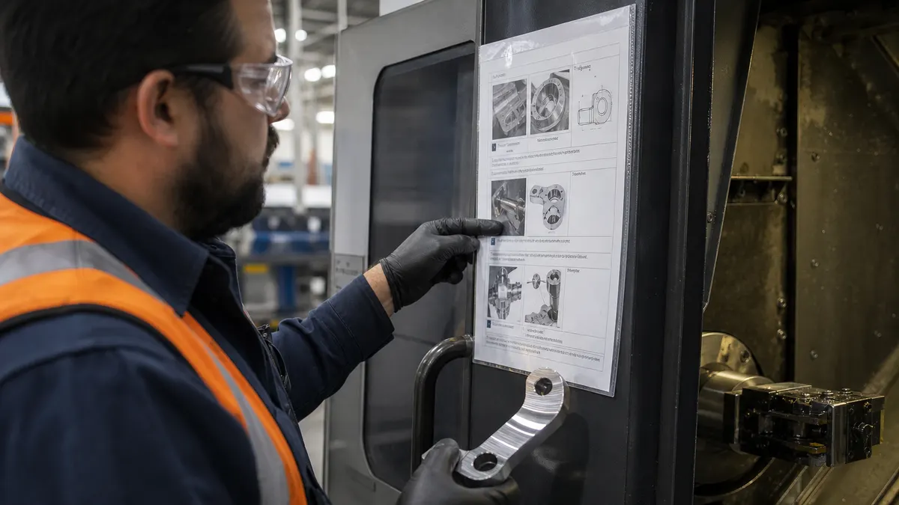
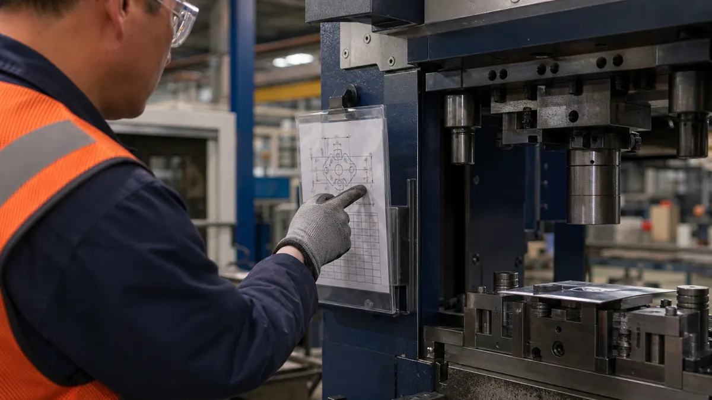

> **Key Takeaways**
>
> - A document control procedure decides which documents are controlled, who approves them, how changes are made and how old versions are removed from use.
> - Auditors look for proof that the people doing the work have the current version in their hands, not only for a tidy document list.
> - Each controlled document needs a named owner, a version identifier and a clear approval record.
> - Obsolete documents can cause problems on a shop floor, so the procedure must say what happens to them on the day a revision is released.
> - Retention periods are set by the organization based on customer, regulatory and legal needs; the standard does not fix one number.

Many shops read the document control requirement as a filing task: put the procedures in a binder, number them and move on. The requirement is really about whether an operator at a machine is working from the right instruction today. An ISO 9001:2026 document control procedure is the written method that makes that true, and it is one of the first things a registrar samples during an audit.

The requirements sit in the documented information clause of the standard. Many certified plants are still on ISO 9001:2015 during the transition to ISO 9001:2026, and in the 2015 edition the relevant text is clause 7.5, with creation and updating in 7.5.2 and control in 7.5.3. The steps below describe the requirements in practical terms, so they hold for either edition. ISO's own [explanation of ISO 9001](https://www.iso.org/home/insights-news/resources/iso-9001-explained.html) is a good plain-language starting point for anyone new to the standard.

## Step 1: Identify Which Documents and Records Need Control

Start with a list of what the plant actually uses to run its processes. Walk the floor and the office with the process owners and write down every instruction, form, drawing, specification and procedure that someone relies on to do the job correctly.

Then split the list in two. **Documents** are what people follow, such as work instructions, control plans, inspection procedures and drawings. **Records** are the evidence of what happened, such as inspection results, calibration certificates and training sign-offs. The two are controlled differently: a document is revised and replaced, while a record is kept as it was created.

What you need for this step is a simple register with a column for the document title, its type, the process it supports and where it is used. A spreadsheet is enough to begin.

A common mistake is to control only the documents the standard names and ignore the ones people really use. Customer drawings, supplier certificates, handwritten setup sheets and the whiteboard charts near a line all influence product quality. If operators rely on it, it belongs on the list or it needs to be removed from the floor.

Some documents come from outside the plant. Customer specifications, regulatory requirements and supplier data sheets still need to be identified and controlled, even though the plant did not write them. The procedure should say who receives them, who checks that they are current and how they reach the people who need them.

## Step 2: Assign Document Owners and Approval Responsibilities

Every controlled document needs one person who answers for it. The owner is usually the process lead who knows how the work is really done, not a quality administrator who files the paperwork.

The procedure should state three roles clearly:

- **The author** drafts or revises the document and checks that it matches how the process runs.
- **The reviewer** confirms the content is accurate and does not conflict with other documents.
- **The approver** has the authority to release it, and the approval is recorded with a date.

Keep the approval matrix short. A work instruction might be approved by the department supervisor, while a quality manual or a procedure that crosses departments might be approved by the quality manager or a member of top management. What matters is that the rule is written down and followed every time.

> **Key Consideration:** Name roles rather than individuals in the procedure itself, such as production supervisor or quality manager. People change jobs, and a role-based rule does not need rewriting when they do.

**Illustrative example:** A 40-person fabrication shop lets any lead hand edit the welding instructions on the shared drive. After a change to a filler material, two shifts follow different versions for a week. Assigning one owner and one approver to the welding instructions would have given the shop a single point where changes are checked and released.

The common mistake here is spreading approval so thin that nobody feels responsible. When five people can approve a document, the audit trail often shows that none of them actually reviewed it.

## Step 3: Set Up Versioning, Review, and Change Control

Each controlled document needs an identifier, a revision level and a date, shown on the document itself. Auditors will pick up a page on the floor and look for these first.

Decide how revisions are numbered and keep the method the same across the plant. A simple letter or number sequence works well. The procedure should also require a short description of what changed and why, so a reader can see the reason for a revision without comparing two files.

The change path should be written as a sequence people can follow:

1. The owner or a requester raises a change, with the reason stated.
2. The reviewer checks the proposed text against related documents and the process it controls.
3. The approver signs off, and the revision level and date are updated.
4. The new version is released and the previous version is withdrawn at the same time.

Documents also need a review cycle. Many plants review each controlled document at a set interval, such as annually, and again whenever a process, customer requirement or regulation changes. The point is to catch instructions that have drifted away from reality, so record the review even when no edit results.

> **Important:** Changes to a document should be reviewed and approved by the same level of authority as the original, unless the procedure explicitly assigns that authority elsewhere.

The common mistake is making an edit directly in the live file with no revision change. Minor wording fixes still alter what people read, so they need the same version trail as a major rewrite.

## Step 4: Make Current Documents Available at Points of Use

A current document that nobody can reach does not help the operator. The standard expects documented information to be available and suitable for use where and when it is needed, so the procedure should name the place each type of document lives.

For a machine shop this may mean laminated instructions at the workstation, a terminal in each cell or a controlled folder the supervisor manages. For a plant with several shifts, it means the same current version on the night shift as on the day shift.

Think through three practical questions as you set this up:

- **Who needs access?** Operators need the work instructions for their station, while only designated people need to edit anything.
- **How is it protected?** Files that are read-only for most users keep unapproved edits out of circulation.
- **What happens when systems are down?** If the plant relies on screens, the procedure should say what backup copy exists and who controls it.

For more detail on how document control fits into the wider management system, the [ISO 9001 quality management service page](/services/iso-9001) and the overview of the [manufacturing industry](/industries/manufacturing) show where this requirement meets day-to-day production.

A common mistake is allowing local copies. Operators print a version just in case, tuck it in a drawer and keep using it long after it has been replaced. The procedure should state that printed copies are either controlled and numbered or treated as uncontrolled and used only for reference.

## Step 5: Prevent the Use of Obsolete Documents

This step helps prevent the use of outdated instructions. Releasing a new revision is easy; removing every copy of the old one is the hard part.

Write down exactly what happens on release day. The owner or document controller should collect the old printed copies, replace them with the new ones and confirm that the shared drive or system now shows only the current revision. Many plants use a simple sign-off sheet that lists each location and the person who swapped the copy.

If an old version must be kept, for example for legal, traceability or knowledge-preservation reasons, mark it clearly. A stamp or watermark reading Obsolete with the date withdrawn is a common approach, and the file should move to an archive location that operators do not use.

> **Did You Know?** The standard requires that documented information retained for any purpose is suitably identified, which is why an obsolete document kept for reference has to be marked as such.

**Illustrative example:** A plant revises an inspection procedure to tighten a tolerance check. The new version is posted at the inspection bench, but an older printout remains clipped inside a toolbox at the finishing cell. A later audit of that cell finds the finishing operator measuring against the previous criteria. A release-day checklist that listed every location, including the toolbox, would have caught it.

The common mistake is treating obsolete control as a one-time clean-up before an audit. It has to be built into every release, so the check happens each time and not only when a registrar is expected.

## Step 6: Define Retention, Access, and Recordkeeping Rules

The last piece covers how long things are kept, where they are stored and who can see them. This applies to both documents and records, and the procedure should state the rule for each type.

The standard does not set a single retention period. The organization decides, based on what its customers require, what regulations apply and what the plant needs for traceability and warranty questions. A customer contract may specify a period, and a regulatory requirement may extend it. Where requirements differ, the longer one applies. The [ISO 9001:2026 page on iso.org](https://www.iso.org/standard/9001) describes the current edition of the standard, but it is the contract and the applicable regulations that set the retention periods.

A practical retention table lists:

- **The record type,** such as inspection results, calibration certificates or corrective action reports.
- **The retention period,** stated in years or tied to a product life or contract term.
- **The storage location,** whether a cabinet, a server folder or a records system.
- **The disposal method,** so that records are destroyed in a controlled way once the period ends.

Records need protection from loss and unauthorized change. Backups for electronic records and a locked cabinet or fire-resistant storage for paper ones are reasonable measures. Access rules should say who can view records, who can add to them and who can never alter them after the fact.

A common mistake is setting one blanket retention period for everything. A calibration certificate for a gauge that is still in service, or a record linked to a safety-critical part, may need to be kept far longer than a routine daily checklist.

## Frequently Asked Questions

### What documents must an ISO 9001 document control procedure cover?

It should cover the documents the plant needs to run its quality management system and the documents the standard requires, such as the quality policy and objectives. It should also cover the work instructions, specifications, drawings and forms operators rely on, along with documents of external origin like customer specifications.

### Who should approve controlled documents under ISO 9001?

The person with the authority and knowledge to release the document should approve it. For a work instruction this is often the supervisor of that area, and for a cross-department procedure it is often the quality manager or top management. The procedure should name the roles and require a dated record of approval.

### How should a manufacturer prevent employees from using obsolete documents?

Combine a release-day routine with visible controls. Collect and replace old printed copies at every location, restrict the shared drive so only the current revision is available, and mark any retained old version as obsolete. A sign-off sheet listing each location makes the check repeatable.

### How long should ISO 9001 records be retained?

The standard leaves the period to the organization. Set it using customer contract terms, regulatory requirements and the plant's own needs for traceability and warranty. Write the period in the procedure for each record type so everyone applies the same rule.

### Can a manufacturer control ISO 9001 documents electronically?

Yes. The standard does not require paper. Electronic control works when access rights, version history, approval records and backup are in place. Plants that run a mix of paper and electronic documents should say in the procedure which is the controlled source.

Keeping approvals, revisions and obsolete copies in step across several shifts is where manual document control tends to slip. ISO Certification Consultants' compliance management software includes a [Documents module](/solutions/document-control/) that keeps current versions, approvals and withdrawn copies in one controlled place, and you can [book a demo](/contact/) to see how it works for your plant.
