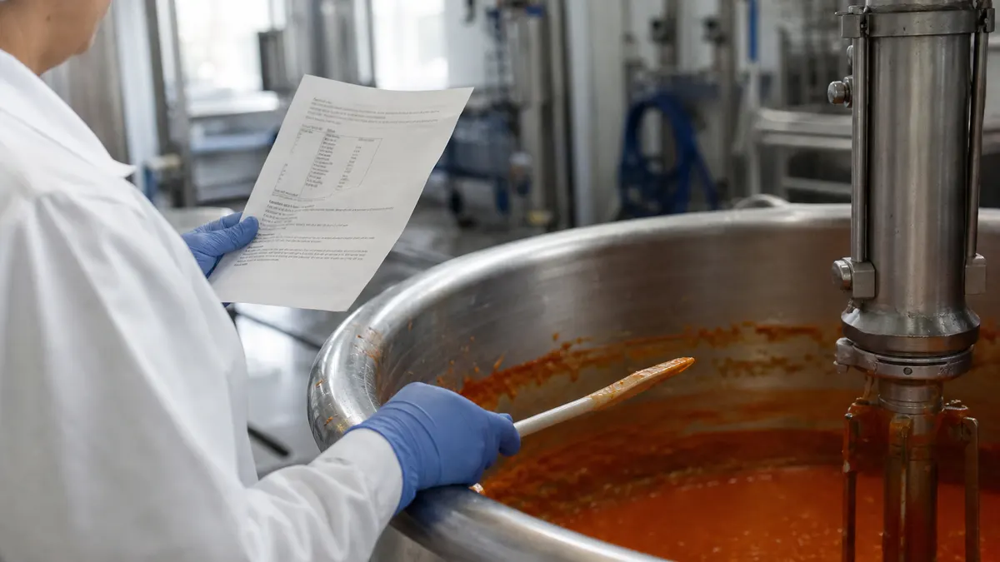
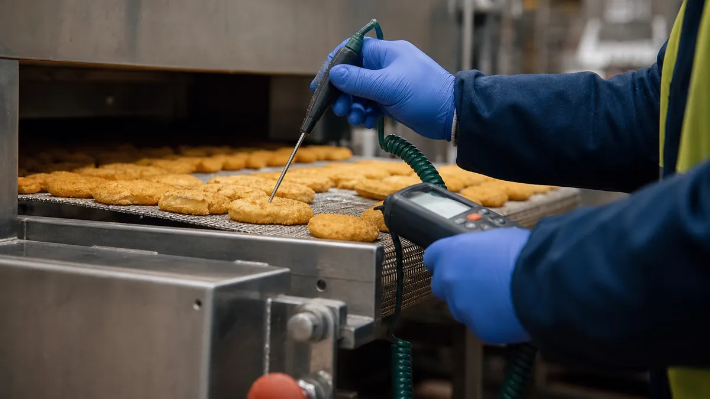

> **Key Takeaways**
>
> - A hazard analysis under ISO 22000:2018 starts with the product and its intended use, not with a list of hazards.
> - A flow diagram that has been walked on the floor is the base every later step depends on.
> - Each identified hazard needs a documented decision: controlled, or not controlled, with the reason written down.
> - Control measures are classified as either critical control points or operational prerequisite programs, and the classification must be justified.
> - The analysis is a living record that changes whenever a product, ingredient, process or supplier changes.

**Illustrative example:** A registrar reviewing a plant's hazard analysis might find a seasoning line described with the hazards of a bakery, suggesting a gap in the analysis. A generic hazard list copied from a template can be one reason for a deficient analysis. Clause 8.5 of ISO 22000:2018 asks for something plant-specific, built on the HACCP principles in the [Codex Alimentarius](https://www.fao.org/fao-who-codexalimentarius/en/), and the ISO 22000 hazard analysis steps below start where the clause starts: with the product.

Read them alongside the plant's own [ISO 22000 service scope](/services/iso-22000) when deciding who sits on the hazard team.

## Step 1: Define the Products, Processes, and Intended Use

Start with the product, because every hazard decision depends on what the product is and who eats it. Clause 8.5.1 of ISO 22000:2018 asks the organization to describe raw materials, ingredients, finished products and the way they will be used. That description is the foundation of the hazard analysis, and gaps here show up as weak decisions later.

**What to do.** Write a product description for each product or product family. Cover composition, physical and chemical properties that affect safety, packaging, storage conditions, shelf life, and the intended use, including who will eat it and how it is prepared.

**What you need.** Recipes or formulations, supplier specifications, packaging specifications, and any customer or regulatory requirements that apply. The [Canadian Food Inspection Agency's food safety guidance for industry](https://inspection.canada.ca/en/food-safety-industry) is a useful reference for federal expectations that sit alongside the standard.

- Group products with the same hazards and the same process into one family, and say in writing why they belong together.
- Record any reasonably foreseeable misuse, such as a ready-to-eat product that a consumer might heat only partly.
- Name vulnerable groups when the product is marketed to them, because the acceptable level for a hazard can change.

**The common mistake.** Describing the product in marketing language instead of safety language. "Premium soup" tells an auditor nothing, while a description that states water activity, storage temperature and the heating instruction does.

## Step 2: Map Process Steps and Confirm the Flow Diagram

Operators often keep a rework bin or a holding cooler that never made it onto the diagram. Clause 8.5.1 also calls for flow diagrams and descriptions of the process steps and control measures, and the hazard team is expected to confirm them on site.

**What to do.** Draw every step from receiving to dispatch, including rework loops, hold points, storage, transfers between areas and any outsourced step. Add the equipment and the control measures that already exist at each step.

**What you need.** The hazard team, a floor plan, and time on the production floor during a real run. Walk the line in the direction of product flow and compare each step with the diagram.

> **Key Consideration:** Walk the diagram on every shift that runs the product.
>
> **Illustrative example:** A night shift might hold product in a different cooler or rework it differently, creating a path the day-shift diagram does not show.

Plant layout belongs in this step as well. Airflow, people movement and the path of allergen-containing ingredients explain how a hazard can reach a product that never touches the ingredient directly.

**The common mistake.** Drawing the diagram from the procedure binder at a desk.

**Illustrative example:** A diagram might show a clean, one-way process without showing a rework bin beside the filler, where a hazard could be present.

## Step 3: Identify Potential Food Safety Hazards

With the diagram confirmed, the team lists the hazards that could reasonably be expected at each step. Clause 8.5.2 of ISO 22000:2018 asks for the identification of hazards related to the product, the process and the plant environment, and for the acceptable level of each hazard in the finished product.

**What to do.** Work through each process step with three questions: what could enter the product here, what could grow here, and what could survive here. Sort the findings into biological, chemical (including allergens) and physical hazards.

**What you need.** Incident and complaint history, supplier information, scientific references, regulatory limits, and the knowledge of maintenance and sanitation staff who see the equipment up close.

- Biological hazards include pathogens that a cook step must destroy and spoilage organisms that grow when a chiller fails.
- Chemical hazards include allergen cross-contact, cleaning chemical residues and contaminants that arrive with raw materials.
- Physical hazards include metal fragments from worn equipment, glass from lighting or jars, and hard plastic from broken tools.

The [ISO 22000:2018 standard page on iso.org](https://www.iso.org/standard/65464.html) is the official reference for what the clause asks the organization to consider. A hazard list should also name the step where each hazard could be introduced, because that is what lets a reader trace the logic later.

**Illustrative example:** A food co-packer near Guelph runs a seasoning blend that contains a tree-nut ingredient on one line and nut-free products on the next. The team lists allergen cross-contact as a hazard at the changeover step, not only at receiving, because shared scoops and the blender are where the transfer could happen.

**The common mistake.** Listing only hazards the plant has already had. A short list with no reasoning invites the auditor to ask what else was considered and dismissed.

## Step 4: Assess Hazards and Determine Which Require Control

Not every identified hazard needs a dedicated control. The assessment is where the team decides which ones do, and the standard expects that decision to rest on likelihood of occurrence and severity of the health effect.

**What to do.** Rate each hazard against the same stated criteria. Decide whether it is significant enough to need a control measure, and record the reasoning for hazards that are judged not to need one.

**What you need.** A written scoring method that every member of the team applies the same way, plus the acceptable level for each hazard from Step 3. A method that nobody can explain is hard to defend.

> **Important:** A hazard judged as not requiring control still needs a recorded reason. Silence is read as an omission, and an auditor cannot tell whether the hazard was assessed or missed.

A simple matrix of likelihood against severity is enough for many plants, as long as the plant defines what each rating means. Anchor the ratings in things the team can point to, such as supplier data, process capability and past nonconformances, instead of gut feel.

- Hazards that the preceding prerequisite programs already keep at an acceptable level can be recorded as controlled by those programs, with the program named.
- Hazards that remain significant move forward to control measure selection in Step 5.
- Hazards with a severe outcome deserve a second look even when the likelihood score is low, because a rare event with a serious consequence is still a food safety event.

**The common mistake.** Scoring every hazard as high so that nothing can be challenged. If everything is critical, the plan cannot tell the operator where to look first, and the team loses the ability to prioritize.

## Step 5: Select Control Measures and Classify Them

Once the significant hazards are known, the team chooses what will keep each one at its acceptable level and then classifies each measure. ISO 22000:2018 separates two categories, and the split matters because each one is managed differently.

**What to do.** For each significant hazard, choose one or more control measures, then classify each as a critical control point or an operational prerequisite program. Check that the measure can be monitored and that a correction is possible when monitoring shows a problem.

| | Critical control point | Operational prerequisite program |
|---|---|---|
| Purpose | Prevents or removes a hazard at a specific step | Controls hazards through a program applied across the plant or area |
| Limits | Critical limits with a clear pass or fail | Action criteria that trigger a response |
| Typical example | A cook step that must reach a set temperature | Allergen changeover cleaning between runs |

Clause 8.5.4 of ISO 22000:2018 covers the hazard control plan, which holds the monitoring, corrections and records for each CCP and OPRP. The measures also need validation before they are relied on, meaning evidence that the control, as designed, can actually achieve the intended result.

**What you need.** Process data, scientific or regulatory support for the limits, equipment capability information and the monitoring methods the operators will use.

**The common mistake.** Treating a prerequisite program as a CCP because it feels important, or the reverse. Classification should follow the logic of the analysis: can the hazard be controlled at one step with a measurable limit, or does it depend on a program applied around the process?

Plants working toward FSSC 22000 Version 7 should note that the scheme adds requirements on top of the standard. The [FSSC scheme documents](https://www.fssc.com/fssc-22000/scheme-documents/) list them, and FSSC 22000 Version 7 is the current version.

## Step 6: Document Decisions and Keep the Analysis Current

**Illustrative example:** A switch from one flour supplier to another could quietly change the allergen and mycotoxin picture on a line that has not changed. The final step is the routine that catches changes like that.

**What to do.** Record the product descriptions, flow diagrams, hazard lists, assessments, classification decisions and the reasoning behind them. Set review triggers, and update the analysis when a trigger occurs.

**What you need.** A controlled place for the records, named owners for each part, and a habit of tying every change request to a question: does this change a hazard?

Common triggers for an update include:

- A new ingredient, a change of supplier or a change in a supplier's process, because each can bring a new hazard.
- New or modified equipment, a layout change or a change in line speed, because these alter how hazards move through the plant.
- A customer complaint, a recall in the sector, a new regulation or a finding from an internal audit.

> **Did You Know?** ISO 22000:2018 asks the organization to keep documented information that shows the hazard analysis was carried out and that its results are current. A binder that has not been touched since certification does not meet that expectation.

The [Safe Food for Canadians Regulations](https://laws-lois.justice.gc.ca/eng/regulations/SOR-2018-108/) set federal expectations for preventive control plans in many food businesses, so a plant that supplies across provincial lines should line up its records with both.

**The common mistake.** Storing the analysis in one person's spreadsheet.

**Illustrative example:** If the person responsible is on leave, others might be unable to show an auditor why a decision was made or notice when a change makes it obsolete. Linking it to the plant's [food and beverage industry quality pressures](/industries/food-beverage) in management review keeps it on the agenda.

## Frequently Asked Questions

### What are the main steps in an ISO 22000 hazard analysis?

Six: product and intended use, process flow, hazard identification, hazard assessment, control measure selection and classification, then documentation and review. In the standard these sit across the preliminary steps, the hazard analysis and the hazard control plan.

### How does a food manufacturer decide whether a hazard needs control?

The team rates the hazard against stated criteria, usually likelihood of occurrence and severity of the health effect, and compares it with the acceptable level for the finished product. If existing prerequisite programs already hold the hazard at an acceptable level, that can be recorded. Otherwise a control measure is needed, and either way the reasoning is written down.

### What is the difference between a CCP and an operational prerequisite program?

A CCP controls a hazard at a specific step with a measurable critical limit, so a failure leads to a clear decision about the product. An operational prerequisite program controls a hazard through a program with action criteria, such as allergen changeover cleaning. The plant decides which category fits by following the logic of its analysis.

### How often should a food plant review its hazard analysis?

The analysis should be reviewed on a planned schedule and whenever something changes that could affect hazards, such as a new ingredient, supplier, process, piece of equipment or complaint trend. The plant sets the schedule in its own procedures, and an auditor will expect to see that it was followed.

### What records should a food manufacturer keep for hazard analysis?

Keep product descriptions, flow diagrams, the hazard list and assessment, the classification of control measures with their validation evidence, the hazard control plan, and the records of reviews and updates. Each record should show who made the decision and why. A [recent article on what ISO 22000 certification requires of Ontario food manufacturers](/blog/what-iso-22000-certification-requires-of-ontario-food-manufacturers) covers the wider record set.

A good test of the finished analysis is to pick one recent change, such as a new sanitation chemical, and trace it through the product description, the flow diagram and the hazard list. If the trace takes minutes, the record is working. ISO Certification Consultants' compliance management software links documents, processes and change requests so that trace stays short, and you can [book a demo](/contact/) to try it on a food plant's own example.
