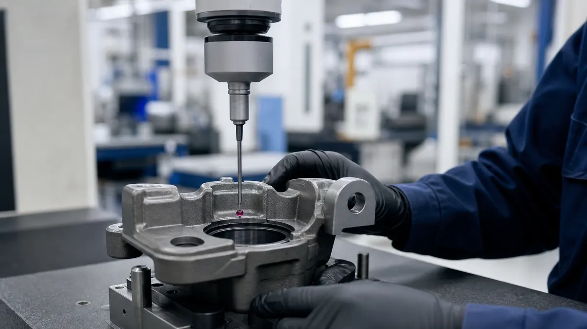
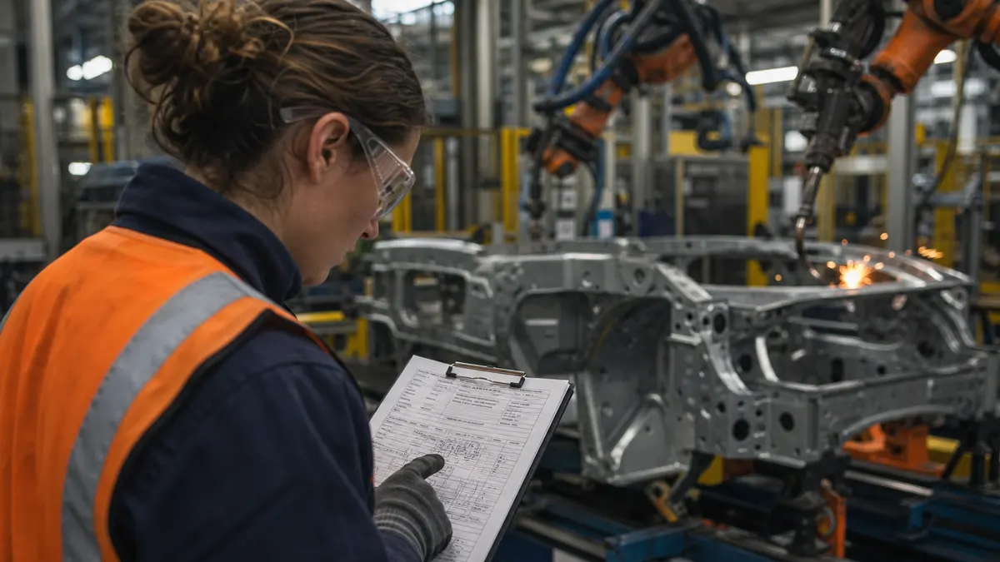

> **Key Takeaways**
>
> - ISO 9001:2026 is a general quality management system standard any organization can use, while IATF 16949:2016 adds automotive-specific requirements on top of it.
> - IATF 16949 is applied together with each automotive customer's own requirements, so the real obligation is wider than the standard itself.
> - Only certain automotive sites are eligible for IATF 16949, and certification is granted only through certification bodies recognized by IATF.
> - Many Ontario plants that supply automotive customers start with ISO 9001 and move to IATF 16949 when a customer or contract requires it.

Many Ontario plants assume that IATF 16949 is simply a stricter ISO 9001, so a shop that already holds an ISO 9001 certificate must be most of the way there. That assumption causes missed deadlines. The IATF 16949 vs ISO 9001 differences go beyond a longer list of clauses: they change who sets the rules, who can be certified, and how the audit is run.

This article compares the two standards for quality managers and plant owners deciding which one fits a real customer base. It covers what each standard is for, how the requirements differ, how customer-specific rules change the picture, and how to plan a move from one to the other.

## What ISO 9001 and IATF 16949 Are Designed to Do

ISO 9001 describes a quality management system in general terms. It is written to fit a stamping plant, a software firm or a food packer equally well, so it sets out what a system must achieve and leaves most of the method to the organization. ISO 9001:2026 is the current edition, published in September 2026 as the sixth edition. Many certified organizations are still on ISO 9001:2015 during the three-year transition, and [the official ISO 9001 page](https://www.iso.org/standard/9001) shows the standard as it now stands. For more on how the standard works in practice, see ISO Certification Consultants' [ISO 9001 quality management service](/services/iso-9001).

IATF 16949 is narrower and more prescriptive. It is the automotive quality management standard, and IATF 16949:2016 is the current edition. IATF has announced a second edition in development, but it has not been published and the 2016 edition remains the valid standard. The body that governs it is [IATF Global Oversight](https://www.iatfglobaloversight.org/), which sets the certification rules and publishes sanctioned interpretations.

The design goals differ as well:

- **ISO 9001 aims at consistent products and customer satisfaction** across any industry, with the organization deciding how much control each process needs.
- **IATF 16949 aims at defect prevention and reduced variation and waste** in the automotive supply chain, and it names specific methods, records and controls to get there.

> **Did You Know?** IATF 16949:2016 is not a standalone replacement for ISO 9001. It is built to be used together with ISO 9001:2015 and with the customer-specific requirements of each automotive customer.

## IATF 16949 vs ISO 9001: Requirements Side by Side

The table below shows where the two standards diverge in day-to-day terms. Cells are short on purpose; the detail follows in the sections after it.

| Topic | ISO 9001 | IATF 16949 |
|---|---|---|
| Industry | Any organization | Automotive production and service parts |
| Governing body | ISO and national bodies | IATF Global Oversight |
| Customer rules | Customer requirements are identified and met | Customer-specific requirements are formally part of the system |
| Core tools | Not named | APQP, PPAP, FMEA, MSA and SPC are expected |
| Supplier control | Controls proportionate to risk | Defined supplier development and monitoring expectations |
| Internal auditing | Planned audits of the system | Audits of the system, processes and product, with auditor competence defined |
| Certification | Any accredited certification body | Certification bodies recognized by IATF |

Several of these deserve a closer look. ISO 9001 asks for risk-based thinking and leaves the tools to the organization. IATF 16949 expects the automotive core tools, which are published by the [Automotive Industry Action Group (AIAG)](https://www.aiag.org/) in North America. The tools cover advanced product quality planning, production part approval, failure mode and effects analysis, measurement system analysis and statistical process control.

**Illustrative example:** A plant that has never produced a control plan or a process flow tied to a failure mode analysis will find this the largest practical gap.

The standards also differ in how they treat people and verification. IATF 16949 sets expectations for the competence of internal auditors, for contingency planning, and for the way a plant verifies that its own processes are effective. ISO 9001:2015 clause 9.2 asks for an internal audit program, but it does not describe auditor qualification in this much detail.

> **Key Consideration:** Do not judge the gap by comparing clause counts. A plant that already runs disciplined process control may close the clause gap quickly, but the core tools, the records and the customer rules usually take longer than the clause reading suggests.

For a deeper look at how the core tools work together, see the [playbook for APQP, PPAP and FMEA](/blog/the-quality-engineers-playbook-for-iatf-16949-core-tools-apqp-ppap-and-fmea).

## How Automotive Customer-Specific Requirements Change the Picture

The most overlooked difference is the role of the customer. Under ISO 9001, a customer's requirements are an input to the system. Under IATF 16949, **each automotive customer's own requirements become part of the certified system**, and the certification body audits against them as well as against the standard.

That matters because the customers do not all ask for the same things. One may require specific reporting formats, another a particular problem-solving method, and a third its own approach to special characteristics or supplier approval.

**Illustrative example:** A plant that supplies two or three vehicle makers can end up with a stack of requirement sets, and each one has to be reflected in procedures, records and training.

**Illustrative example:** A plant that machines transmission components for two different vehicle makers builds one control plan format around the standard. The first customer later asks for a different format and its own deviation approval step. The plant now keeps two variations of the same control plan, assigns an owner for each customer's rules, and checks both in its internal audit program.

Two habits help plants keep this manageable:

- **Keep a register of customer-specific requirements** that names the customer, the requirement, the process it touches and the person who owns it.
- **Review the register whenever a customer issues an update,** so that the system changes at the same time the customer's expectations do.

The detail of how these requirements land on Ontario suppliers is covered in the article on [customer-specific requirements for Ontario automotive suppliers](/blog/what-iatf-16949-customer-specific-requirements-demand-from-ontario-automotive).

## Differences in Certification Scope and Audit Expectations

Eligibility is a real boundary. ISO 9001 certification is open to any organization that wants it. IATF 16949 is meant for sites that make automotive production parts, service parts or accessories, and the rules on which sites qualify are set by IATF. Support functions such as design or distribution can fall inside the scope of a certified manufacturing site, but the rules on remote support functions are specific, so confirm them with a recognized certification body before planning around them. [IATF's own description of the standard](https://www.iatfglobaloversight.org/iatf-169492016/about/) is the place to start.

Audits also feel different. An ISO 9001 audit samples the system against the standard and the organization's own documented approach. An IATF 16949 audit is built around the process approach and adds product audits, customer-specific requirement checks and a stricter view of how a plant responds to nonconformities. Certification bodies must be recognized by IATF, and their auditors must meet IATF competence rules.

Here is what that means in practice:

- **Audit time is usually longer and the audit plan is more structured,** because more processes, more customer rules and more records fall inside the scope.
- **Findings are handled under defined rules,** so a nonconformity cannot simply be left to the next surveillance visit.
- **The audit evidence points back to customers,** because performance data and customer complaints are part of what the auditor reviews.

> **Important:** An ISO 9001 certificate does not count as an IATF 16949 certificate, and a plant cannot claim IATF 16949 conformity without a certificate from a recognized certification body.

## Which Standard Fits Your Manufacturing Business?

The right choice usually follows the customer rather than the plant's preference. These questions help sort it out:

1. **Do your customers require IATF 16949 in their supplier terms?** If a vehicle maker or a Tier 1 supplier has put it in writing, the question is already answered, and ISO 9001 alone will not meet it.
2. **Do you make production parts, service parts or accessories for vehicles?** If not, the site is probably not eligible, and ISO 9001 is the appropriate standard.
3. **Do you serve automotive and other sectors?** A plant can hold both certificates, and many do while the automotive share of the business is still growing.
4. **Is the customer asking for a quality system, or for automotive discipline?** A general industrial customer that wants evidence of control is usually satisfied by ISO 9001, while an automotive program usually wants the core tools and customer rules.

ISO Certification Consultants describe the automotive route on the [IATF 16949 automotive quality page](/services/iatf-16949) and its place in the sector on the [automotive industry page](/industries/automotive).

For a plant already holding ISO 9001, the choice often comes down to timing. If no automotive customer is asking yet, ISO 9001 can stay as the base. If a customer has issued a letter or a request for quotation that mentions IATF 16949, planning should start before the deadline, not after it.

## How to Plan a Transition from ISO 9001 to IATF 16949

A plant moving from ISO 9001 to IATF 16949 is not starting over. The existing system is the foundation, and the work is in the additions. A practical sequence looks like this:

1. **Confirm scope and eligibility** with a recognized certification body, including which sites and functions are in or out.
2. **Collect every customer-specific requirement** and map each to a process, an owner and a record.
3. **Compare the current system with IATF 16949:2016,** clause by clause, and list the gaps in the core tools, the audits and the supplier controls.
4. **Close the gaps and run the system long enough to produce records.** Auditors look for evidence of operation, not only for procedures.
5. **Run internal audits of the system, the processes and the product,** with auditors who meet the competence rules.
6. **Schedule the certification audit** with the recognized certification body and allow time to close any findings.

A plant that handles one product family is often able to finish in less time than a plant with several customers and several processes. Typical estimates run from several months to more than a year, depending on how many customer rules apply and how much of the core tool work is already in place.

## Frequently Asked Questions

### Does IATF 16949 include ISO 9001 requirements?

IATF 16949:2016 is written to be applied together with ISO 9001:2015, and it carries the ISO 9001:2015 requirements as its base. It then adds automotive-specific requirements. Many plants are still on ISO 9001:2015 while the transition to ISO 9001:2026 runs through September 2029, so check which edition your customer and certification body expect.

### Can a non-automotive manufacturer become IATF 16949 certified?

Generally not. The standard is meant for sites that make automotive production parts, service parts or accessories, and IATF sets the eligibility rules. A plant outside that scope usually gets more value from ISO 9001 or from a sector standard that fits its own customers.

### How does IATF 16949 certification affect automotive supplier eligibility?

Many vehicle makers and Tier 1 suppliers require it in their supplier terms, so holding the certificate can decide whether a plant is considered for new work. The exact requirement is set by each customer, so confirm it in the customer's supplier documents. The [Automotive Parts Manufacturers' Association](https://www.apma.ca/) is also a useful contact for suppliers in Canada.

### Does ISO 9001 certification satisfy automotive customer requirements?

Sometimes, but not always. Some automotive customers accept ISO 9001 for lower-tier or non-production suppliers, while others require IATF 16949 or their own supplier approval process. Read the customer's supplier quality manual before assuming that an ISO 9001 certificate is enough.

### How long does it take to transition from ISO 9001 to IATF 16949?

Typical estimates run from several months to more than a year, depending on scope, the number of customers and how much of the core tool work already exists. A plant with disciplined process control and clear records tends to move faster than a plant that has to build those habits first.

If you are weighing the two standards for your plant, a short conversation can sort out which one your customers actually expect and what the gap looks like. ISO Certification Consultants work with Ontario manufacturers on both routes, and you can [book a consultation](/contact) to compare your current system with the standard before a customer deadline arrives.
