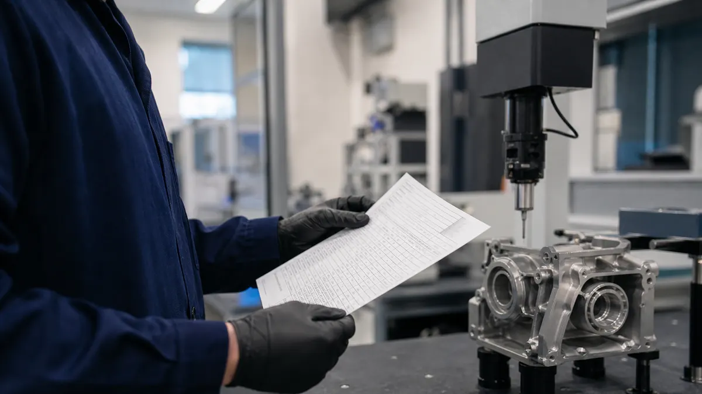
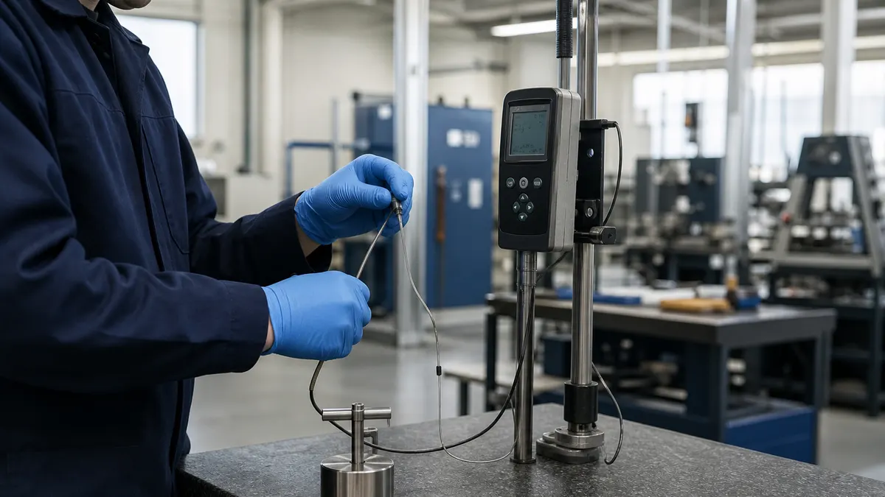

> **Key Takeaways**
>
> - An ISO/IEC 17025:2017 internal audit checklist for a laboratory works best when it follows the laboratory's own processes, not just the clause order of ISO/IEC 17025:2017.
> - Ten areas provide a practical structure for reviewing a laboratory's work: scope, impartiality, people, facilities, equipment, methods, records, result validity, reporting and corrective action.
> - Each item should be tested against evidence, such as a signed authorization or a calibration certificate, and not against a verbal answer.
> - Findings only count if they are closed with a verified corrective action before the accreditation assessment.

What does a laboratory need to check before an accreditation body walks through the door? An ISO 17025 internal audit checklist gives the quality manager a structured way to answer that question while there is still time to fix gaps. ISO/IEC 17025:2017 is the current edition, and no newer edition has been published.

The standard requires the laboratory to run internal audits at planned intervals, and it expects the results to feed management review. The ten areas below follow the path a sample takes through a laboratory, from the decision to accept work to the final report and the follow-up. For the official description of the standard, see the [ISO/IEC 17025:2017 page on iso.org](https://www.iso.org/standard/66912.html).

Laboratories that want a broader view of how accreditation fits a manufacturing business can read about [ISO/IEC 17025 lab accreditation](/services/iso-17025) before building the audit program.

## 1. Confirm the audit scope, criteria and schedule

Start by writing down what the audit covers: which technical activities, which locations, which time period and which version of the laboratory's procedures. The criteria are ISO/IEC 17025:2017, the accreditation body's requirements and the laboratory's own documented methods. Clause 8.8 of ISO/IEC 17025:2017 asks for an audit program that considers the importance of the laboratory activities, changes affecting the laboratory and the results of earlier audits.

A practical check is to look at whether every accredited test or calibration has been covered at least once within the laboratory's chosen cycle. If one method has gone untouched for several cycles, the schedule needs to change. The audit program should also show that auditors are selected so they do not audit their own work.

## 2. Check impartiality and confidentiality controls

Clause 4.1 of ISO/IEC 17025:2017 requires the laboratory to identify risks to impartiality on an ongoing basis. Clause 4.2 covers confidentiality of customer information. An auditor looks for a written way to identify these risks and for evidence that the review happens again when something changes.

- **Review the impartiality risk assessment** and confirm it names real pressures, such as a customer who is also a major supplier, or a manager who sets both production targets and test acceptance.
- Confirm that staff understand which customer information is confidential and how it is protected in the laboratory system.
- Ask whether any customer has ever requested a change to a result, and check how the laboratory handled that request.

## 3. Verify personnel competence and authorization

Clause 6.2 of ISO/IEC 17025:2017 expects the laboratory to define competence requirements for each function and to authorize people to perform specific tasks. A training certificate alone does not show that a technician is competent to run a particular test today. The audit should trace from the method to the person who performs it and back to the evidence of their competence.

> **Key Consideration:** Pick three methods at random, find who performed the most recent work, and pull the matching authorization and competence records. If any link is missing, the gap is likely to appear in an assessor's sample too.

Check that authorizations are current, that monitoring of staff performance is recorded, and that new technicians were supervised before working alone. The [Training module](/solutions/training-competence/) of the compliance management software is one way to keep these records together, with expiring authorizations flagged for a person to review.

## 4. Review facilities and environmental conditions

Clause 6.3 of ISO/IEC 17025:2017 requires that facilities and environmental conditions suit the laboratory activities and do not invalidate results. Walk the laboratory with the method requirements in hand and compare the actual temperature, humidity, cleanliness or vibration control with what the method asks for.

Look at the monitoring records and ask what happens when a reading goes out of range. The laboratory should be able to show that it stops work, evaluates affected results and records the decision. Also check that access to sensitive areas is controlled and that incompatible activities are kept apart.

## 5. Inspect equipment, calibration and measurement traceability

Clause 6.4 of ISO/IEC 17025:2017 covers equipment, and clause 6.5 covers metrological traceability. Between them they require that equipment is suited to its purpose, calibrated where needed, and linked to the International System of Units through an unbroken chain of calibrations. This area is where many laboratories find the most findings, because the volume of records is high.

Take an equipment list and test a sample against the following points:

- Each item has a unique identification and a current calibration status that is visible on the equipment or in the system.
- The calibration certificates come from providers whose competence is demonstrated, and the stated uncertainty is suitable for the intended use.
- Intermediate checks happen on the intervals the laboratory defined, and the results are recorded.
- Equipment that has been overloaded, mishandled or found out of tolerance is taken out of service until checked.

When a calibration shows a device was out of tolerance, the audit should confirm that the laboratory looked back at results produced since the last good calibration. For measurement uncertainty, the [BIPM publications on the Guide to the expression of uncertainty in measurement](https://www.bipm.org/en/committees/jc/jcgm/publications) are the common reference.

## 6. Assess test and calibration methods

Clause 7.2 of ISO/IEC 17025:2017 covers selection, verification and validation of methods. The audit should confirm that the laboratory uses current versions of standard methods, that it verified its ability to perform them before use, and that any non-standard or modified method was validated. Clause 7.6 requires evaluation of measurement uncertainty, so check that the uncertainty budgets are current and match the way the work is actually done.

Compare the method on the bench with the method on paper. Technicians sometimes add shortcuts over time, and the audit is the place to catch them. Also check that customers were told when a method differs from their request, and that a decision rule is agreed where a statement of conformity is given.

## 7. Examine sample handling and technical records

Clause 7.4 of ISO/IEC 17025:2017 covers handling of test and calibration items, and clause 7.5 covers technical records. Follow one item from receipt to disposal and look for gaps in identification, storage conditions and chain of custody. Records should contain enough information that another competent person could repeat the work and reach the same result.

> **Important:** Changes to technical records must be traceable. A corrected entry should show the original value, the correction, who made it and when, so that the original is never lost.

Check that observations were recorded at the time they were made, not reconstructed afterward, and that electronic systems control who can edit data. The [Documents module](/solutions/document-control/) of the compliance management software handles controlled procedures and forms, and the audit should confirm that technicians work from the current revision.

## 8. Verify validity of results and quality control activities

Clause 7.7 of ISO/IEC 17025:2017 requires a procedure for monitoring the validity of results. Laboratories commonly use reference materials, replicate tests, intermediate checks, retesting of retained items and participation in proficiency testing or interlaboratory comparisons. The audit asks whether the laboratory plans these activities and reviews the data for trends.

Review the last cycle of quality control results and look for what happened when a result fell outside the acceptance limits. The laboratory should have recorded the cause, assessed whether reported results were affected and taken action. Canadian accreditation and proficiency testing details are available from the [Canadian Association for Laboratory Accreditation](https://cala.ca/), which lists the programs available to laboratories.

## 9. Review reporting, complaints and nonconforming work

Clause 7.8 of ISO/IEC 17025:2017 lists what a report must contain. Pull several recent reports and check each against the requirements for identification, method, results, units, authorization and any statement of conformity. Clause 7.9 covers complaints, and clause 7.10 covers nonconforming work.

- **Confirm reports are issued only by authorized people** and that amended reports clearly identify what was changed and why.
- Check that every complaint has a recorded receipt, investigation and response to the complainant.
- Verify that nonconforming work was stopped, evaluated for significance and, where needed, reported to the customer with the work recalled.

A common weakness is a complaint log that records receipt but never shows the outcome. If the laboratory cannot show that the complaint was closed, an assessor will likely ask for it.

## 10. Check corrective actions and audit follow-up

Clause 8.7 of ISO/IEC 17025:2017 sets out corrective action, and clause 8.9 covers management review. The audit should confirm that each finding from the previous audit has a documented cause, an action, an owner and a check that the action worked. Fixing the symptom without finding the cause is the usual reason the same finding returns.

**Illustrative example:** A laboratory finds that two calibration certificates were filed without review. Correcting those two certificates addresses the symptom. The corrective action asks why review was skipped, perhaps because the reviewer was on leave and no backup was named, and then changes the process so the gap cannot recur.

Audit results should reach top management through the management review. If the reviews do not discuss audit results, the audit program is not doing its job. The [Improvements module](/solutions/nonconformance-capa/) of the compliance management software is built for tracking findings through to verified closure.

## Quick-reference summary

| Area | What to verify | Key evidence |
|---|---|---|
| Scope and schedule | Coverage of all accredited activities | Audit program, plan |
| Impartiality | Risks identified and reviewed | Risk assessment |
| Personnel | Authorization for each task | Competence records |
| Facilities | Conditions meet method needs | Monitoring logs |
| Equipment | Calibration and traceability | Certificates, checks |
| Methods | Verified, validated, current | Validation files |
| Records | Traceable and complete | Worksheets, logs |
| Result validity | Planned quality control | Control charts, proficiency results |
| Reporting | Reports meet requirements | Issued reports |
| Corrective action | Causes found, effectiveness checked | Action records |

Laboratories that also run an ISO 9001 system should read how [internal audits differ from external audits](/blog/internal-audit-vs-external-audit-in-iso-how-ontario-manufacturers-should-prepare), since the preparation habits carry over.

## Frequently Asked Questions

### How often should an ISO 17025 laboratory conduct internal audits?

The standard requires audits at planned intervals and does not set a fixed frequency. Many laboratories cover the full scope once a year and audit higher-risk activities more often. The program should reflect the importance of the work, changes in the laboratory and past results.

### Who can perform an ISO 17025 internal audit?

Any person with the right training and independence from the activity being audited can do it. Larger laboratories often use staff from another department, while smaller ones may bring in an outside auditor. Auditors need to understand both the standard and the technical methods they review. Guidance on auditing practice is available in ISO 19011:2026.

### What records should a laboratory review during an ISO 17025 audit?

Auditors typically sample technical records, calibration certificates, authorization and training files, quality control data, complaint logs and previous corrective actions. The sample should follow real jobs from request to report. Records are more useful than procedures because they show what actually happened.

### Does an ISO 17025 internal audit need to cover every clause?

Over the program cycle, yes: all requirements of ISO/IEC 17025:2017 that apply to the laboratory should be audited. A single audit can cover a subset, as long as the schedule shows complete coverage across the cycle. Technical activities deserve sampling every cycle.

### How should a laboratory address findings from an internal audit?

Record each finding against a specific requirement, find the cause, assign an owner and a due date, and verify that the action worked. Serious findings should go to top management without waiting for the next review. The laboratory should be able to show the whole chain to an assessor.

Chasing calibration due dates, authorizations and open corrective actions across spreadsheets is where laboratory audit preparation tends to slip. ISO Certification Consultants' compliance management software keeps these records in one place, with [Audits](/solutions/audits-management-review/) and improvement actions connected, and you can [book a demo](/contact/) to see how it works for a testing or calibration laboratory.
