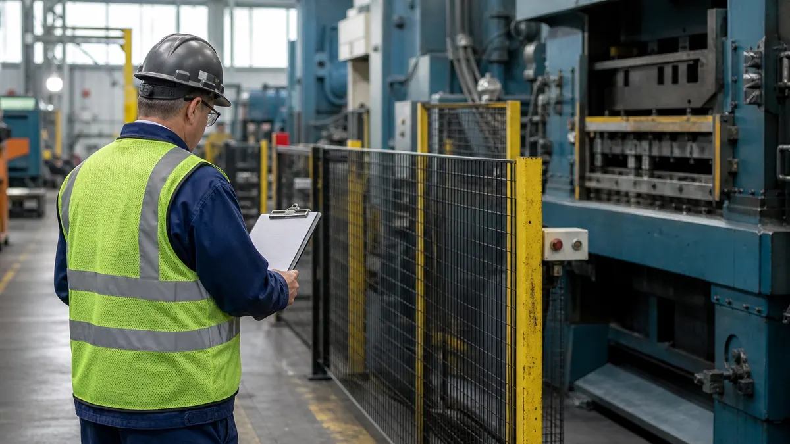
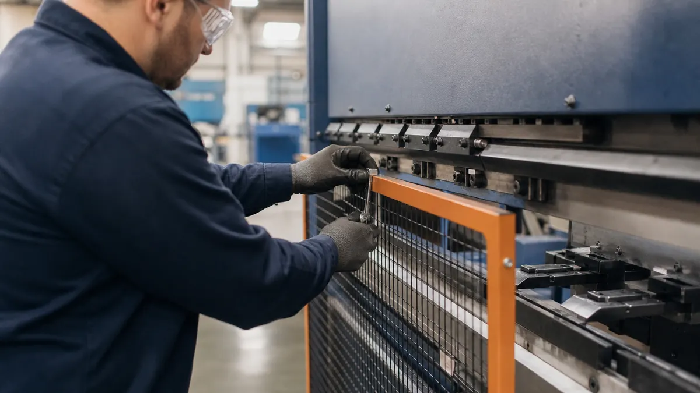

> **Key Takeaways**
> - **Illustrative example:** A near miss at a press line, such as a guard bypassed during a die change, shows how quickly a written system and daily practice can drift apart.
> - Hazard identification, worker participation and legal compliance are the areas auditors probe hardest in manufacturing.
> - Every item below names the evidence an auditor will ask to see, so you can gather it before the audit.
> - Emergency drills, internal audits and corrective actions show whether the system is alive or only written down.

**Illustrative example:** Picture a stamping operator who clears a jam on a press by reaching past a guard because the line is behind schedule, and a supervisor who sees it and says nothing. The written procedure forbids it, yet nothing in the system caught it. An ISO 45001:2018 requirements checklist for manufacturing exists to find exactly this kind of gap: ten areas, each with the evidence that shows whether the requirement works in practice. The current edition is ISO 45001:2018, and no newer edition has been published, so the clause numbers below refer to that edition.

Use the list as a walk-through with your safety lead, a supervisor and a few operators. Read each item, find the record, and mark it as met, partly met or missing. Plants that want the wider picture can pair it with the [ISO 45001 OH&S Management](/services/iso-45001) service overview and the [manufacturing industry](/industries/manufacturing) page.

## 1. Confirm the OH&S Management System Scope and Context

Clause 4 of ISO 45001:2018 asks the organization to understand its context, the needs of workers and other interested parties, and to set the scope of the system. For a manufacturer, that means the scope names the sites, shifts, contractors and activities it covers, and explains any exclusion.

Check that the scope statement matches what actually happens on site. A scope that ignores a night shift, a maintenance contractor or a loading dock is an easy finding.

Also confirm the list of interested parties is real. Customers, insurers, regulators, temporary agency workers and neighbors all have expectations, and the plant should be able to say which of them become requirements it chooses to meet. Read [ISO's own page for ISO 45001:2018](https://www.iso.org/standard/63787.html) if you want the official description of what the standard covers.

## 2. Verify Leadership, Policy, and Accountability

Clause 5 puts responsibility on top management, not on the safety coordinator. The policy must commit to eliminating hazards, reducing risks and consulting workers, and it must be communicated and available.

Look for evidence that leaders act on it:

- Management review minutes show safety results being discussed and resources being assigned.
- Roles and authorities for safety are written down and known by the people who hold them.
- Supervisors can explain the policy in their own words when asked on the floor.

## 3. Check Worker Consultation and Participation

Clause 5.4 requires processes for consultation and participation of workers, including non-managerial workers. Participation means workers take part in hazard identification, incident investigation and decisions on controls, not only that they receive notices.

Test it by asking operators on different shifts, not only those on the committee, how they raise a hazard and what happened the last time they did. The guide on [how to meet ISO 45001 worker participation requirements](/blog/how-to-meet-iso-45001-worker-participation-requirements-in-6-steps) walks through the steps in more detail. In Ontario, the [Ministry guidance on health and safety committees](https://www.ontario.ca/page/guide-health-and-safety-committees-and-representatives) is not listed here as a requirement of the standard, but the committee records often serve as evidence.

> **Important:** Records of who was consulted, on what, and what changed as a result are what an auditor looks for. A meeting that produced no recorded outcome is weak evidence.

## 4. Review Hazard Identification and Risk Assessment

Clause 6.1.2 expects a process that identifies hazards on an ongoing and proactive basis, covering routine and non-routine activities, people with access to the workplace, and changes. In a manufacturing plant, that includes machine setup, lockout, material handling, noise, chemicals, ergonomics and maintenance work.

Check that the assessment is current and tied to the real work. The [CCOHS guidance on hazard identification](https://www.ccohs.ca/oshanswers/hsprograms/hazard/hazard_identification.html) is a practical reference for how to inspect and record hazards.

1. Compare the hazard register against a walk of the floor and note anything missing.
2. Confirm each significant hazard has a ranked risk and an assigned control.
3. Verify that a new machine, process or material triggers a fresh assessment.

## 5. Confirm Legal Requirements and Compliance Evaluation

Clause 6.1.3 requires the organization to determine the legal and other requirements that apply to its hazards, and clause 9.1.2 requires it to evaluate compliance at planned intervals. In Ontario, the [Occupational Health and Safety Act](https://www.ontario.ca/laws/statute/90o01) sets the core duties of employers, supervisors and workers, and a plant may also have customer or insurer requirements.

Check that there is a maintained list of the applicable requirements, an owner for each, and a dated evaluation. A list that was built once and never reviewed will not satisfy the clause.

## 6. Check OH&S Objectives and Action Plans

Clause 6.2 asks for measurable OH&S objectives that fit the policy, with plans stating who does what, with which resources and by when. Objectives such as reducing a specific type of injury or completing a guarding upgrade on named machines are easier to verify than a general wish to be safer.

Confirm progress is reviewed and that missed targets lead to a decision. An objective that never changes over several years usually means nobody is checking it.

Check too that the plan has real resources behind it. A guarding upgrade with no budget line, or a training goal with no scheduled time away from the line, will stall, and an auditor will see that quickly.

## 7. Verify Operational Controls for Significant Risks

Clause 8.1 requires operational controls that follow the hierarchy of controls: eliminate the hazard first, then substitute, use engineering controls, administrative controls and finally personal protective equipment. It also covers management of change, procurement and contractors.

Many plants lean on PPE and signs because they are quick. Ask which significant hazards still depend on those alone, and whether anything higher in the hierarchy was considered.

**Illustrative example:** A welding contractor brought in over a long weekend needs the same hazard briefing, permits and supervision as employees, and the plant should hold the record that shows it happened.

> **Key Consideration:** Pick two high-risk tasks, such as lockout during die changes and forklift traffic, and trace each from the risk assessment to the written control to the practice you see on the floor. Gaps between those three show where to focus first.

## 8. Test Emergency Preparedness and Response

Clause 8.2 requires procedures for foreseeable emergencies, planned responses, training, periodic testing, and review after drills or real events. For a plant, that typically includes fire, chemical release, serious injury, equipment entrapment and power failure.

**Illustrative example:** A machining plant runs an evacuation drill on first shift every time. During a review, the team notices that nobody has tested the response on the night shift, where only a few people are on site and the first aid attendant is not present. The plan is then revised to cover reduced staffing.

Check the drill records for dates, shifts covered, problems found and the fixes made afterward. Confirm too that first aid supplies, eyewash stations, spill kits and exits are inspected and kept clear, since a good plan fails when the equipment is missing or blocked.

## 9. Review Monitoring, Measurement, and Internal Audits

Clause 9.1 requires the organization to decide what to monitor and measure, and clause 9.2 requires internal audits at planned intervals. Both leading indicators, such as hazard reports closed and inspections completed, and lagging ones, such as recordable injuries, help show how the system performs.

Confirm the audit program covers every part of the system, that auditors are independent of the area they audit, and that findings reach management. The [gap analysis checklist for manufacturers](/blog/9-point-iso-gap-analysis-checklist-for-manufacturers-before-certification) is a useful companion before a first audit.

## 10. Confirm Incident Follow-Up and Corrective Action

Clause 10.2 requires a process to react to incidents and nonconformities, investigate, determine root causes, take action and check that the action worked. Near misses count, and they are often the cheapest warning a plant gets.

Open a recent investigation and read it start to finish, then ask a worker involved whether the account is accurate. Look for a root cause beyond "operator error", a corrective action with an owner and a date, and a follow-up check that the fix held.

## Quick-Reference Summary

Safety leads can read this list as a handoff to management review: each "no" is a decision for someone with authority to assign resources, not a task to absorb quietly. Production managers can use the same lines to see which gaps touch their schedules, such as drill time, lockout downtime or audit access.

- Does the scope match the real sites, shifts and contractors?
- Can leaders and supervisors show they act on the policy?
- Can workers describe how they report hazards and what came of it?
- Is the hazard register current and linked to controls?
- Is there a legal requirements list with an owner and a dated evaluation?
- Do the objectives have owners, dates and review records?
- Do high-risk tasks rely on more than PPE and signs?
- Have emergency drills covered every shift and led to improvements?
- Have internal audits covered the whole system?
- Do investigations reach root causes and verify the fix?

Plants preparing in earnest often work through the steps in [the plant manager's playbook for ISO 45001 certification in Ontario](/blog/the-plant-managers-playbook-for-iso-45001-certification-in-ontario) to turn the gaps into a plan.

## Frequently Asked Questions

### What does an ISO 45001 requirements checklist cover for a manufacturing site?

It covers the requirements of ISO 45001:2018, from context and leadership through planning, operation, performance evaluation and improvement. For a manufacturer, it focuses on machine hazards, contractor control, emergency readiness and the records that prove the system works.

### How often should a manufacturer review its ISO 45001 requirements?

The standard does not set one fixed interval for the whole checklist. A common approach is to review the full list at least once a year ahead of management review, and sooner after a major incident, a process change or a change in legal requirements.

### Does ISO 45001 require worker participation in hazard assessments?

Yes. Clause 5.4 requires participation of workers in hazard identification and risk assessment, among other activities. The records should show who took part and how their input was used.

### What records should a manufacturing company keep for ISO 45001 audits?

Keep the scope, policy, hazard and risk assessments, the legal requirements list, objectives, training and competence records, drill results, monitoring data, internal audit reports, incident investigations and corrective actions. The standard says which items must be documented information, and the plant decides the rest based on need.

### How can a manufacturer check whether its emergency procedures are effective?

Test them through drills that cover different shifts and scenarios, then record what went wrong and fix it. Review the procedures again after any real emergency or near miss.

A corrective action that sits in a spreadsheet nobody opens is the quiet reason the same near miss returns a year later. ISO Certification Consultants' compliance management software ties hazards, actions and audit evidence together, including the [Safety](/solutions/safety/) module for incidents and follow-up, and you can [book a demo](/contact/) to see how it fits your plant.
