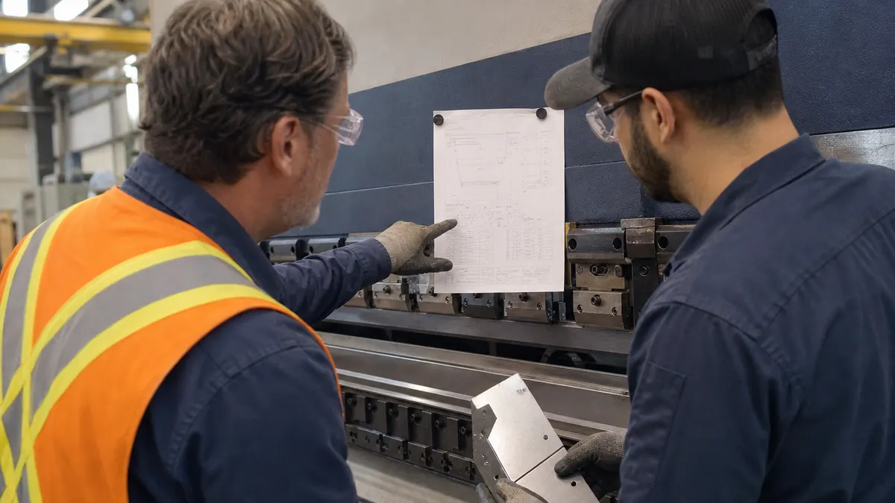

> **Key Takeaways**
>
> - The ISO 9001:2026 certification timeline for a small manufacturer depends far more on how much of the system already exists and how many hours people can protect each week than on the size of the building.
> - A typical project moves through readiness assessment, system building, internal audit, management review and a two-stage certification audit, and each stage has its own waiting points.
> - Delays can arise from unassigned owners, records that do not exist yet, a late internal audit or a certification body calendar that was never checked.
> - Planning backward from a realistic audit date, with named people and protected hours, is more reliable than promising a fixed number of months.

Ask three plant managers how long ISO 9001 certification takes and the answers will differ, and all three may be right. The ISO 9001 certification timeline for a small manufacturer is not a fixed duration set by the standard. The standard sets requirements; the calendar is set by the gap between those requirements and what the shop already does, plus the hours the team can spare while orders keep shipping.

**Illustrative example:** A 40-person machine shop where the quality lead also runs final inspection may move the project forward in the gaps between shipments, so the timeline needs to account for that reality. Many certified organizations are still on the 2015 edition, and the current edition is ISO 9001:2026, published in September 2026. Certificates to the 2015 edition remain valid during a three-year transition that ends in September 2029, so a shop starting today should confirm with its chosen certification body which edition it will be audited against.

## What Determines an ISO 9001 Certification Timeline?

Four things shape the schedule more than anything else. Looking at them first keeps the later stages in proportion.

- **Starting point:** A shop that already controls drawings, calibrates gauges and records corrective actions has a shorter path than one that runs on tribal knowledge and verbal instructions.
- **Available hours:** Someone has to write procedures, gather records and sit through audits. A quality manager who also runs receiving inspection has fewer of those hours than a dedicated coordinator.
- **Management involvement:** Top management has to set the quality policy, review performance and make decisions. When leaders attend on schedule, the project moves; when they do not, it waits.
- **Certification body availability:** Auditors are booked ahead, and the audit calendar is a fixed point that the rest of the plan has to fit around.

The audit date is the only hard deadline. Every earlier milestone can slip a little, but not past the point where the internal audit and its corrective actions no longer fit before the auditor arrives.

> **Key Consideration:** Treat any single number quoted for certification duration as an estimate for a typical shop, not a promise. A shop with an established quality program and a strong coordinator may finish much sooner than one building its first documented system.

## The Main Stages from Readiness Assessment to Certification

The [six-stage certification process](/process) used by ISO Certification Consultants covers each step in detail; what follows concentrates on timing.

### Readiness assessment

Everything else in the schedule depends on this step, because no responsible range can be given before someone has looked at the shop. A [free ISO readiness assessment](/assessment) is one way to get that look early, and its output, a list of gaps sized by effort, is what every later estimate is built from.

This stage is short compared with the others, but skipping it is what makes later estimates unreliable. Without it, the project plan is a guess.

### Building and implementing the system

This is the longest stage and the one most affected by staffing. It covers defining the scope, documenting the processes the standard expects, assigning process owners and, importantly, running the processes long enough to generate records.

Records are the part many shops underestimate. A procedure can be written in an afternoon, but an auditor wants evidence that it has been followed, and that evidence only exists after the process has run for a while. A document control procedure, for example, needs revision history and approvals to show for it; the guide on [creating an ISO 9001 document control procedure](/blog/how-to-create-an-iso-9001-document-control-procedure-in-6-steps) shows what that evidence looks like.

### Internal audit and management review

Clause 9.2 of ISO 9001:2015 requires internal audits at planned intervals, and clause 9.3 requires management review. Both have to happen before the certification audit, and both produce findings that need time to close. The article on [internal audit versus external audit](/blog/internal-audit-vs-external-audit-in-iso-how-ontario-manufacturers-should-prepare) explains how the two differ and how to prepare for each.

Shops that schedule the internal audit late leave no room to fix what it finds. That is one of the most common reasons an audit date has to be pushed back.

### The certification audit

The certification body typically audits in two stages. The first checks that the documented system is ready and that the shop understands what is coming. The second looks for evidence that the system is implemented and effective across the shop floor. Any nonconformities raised need corrective action, and the certificate is decided after the body reviews the response.

The certification body issuing the certificate should be accredited. The [Standards Council of Canada](https://scc-ccn.ca/accreditation) is the national accreditation body, and it accredits the certification bodies that issue ISO certificates in Canada.

## How to Estimate Time for Implementation and Audit Preparation

An honest estimate starts from effort, not from a calendar. The following approach gives a defensible range without pretending to precision.

1. **List the gaps from the readiness assessment.** Every gap becomes a task with an owner, such as writing a procedure, creating a form or training a group.
2. **Estimate hours per task in ranges.** A simple procedure might take a few hours, while a process that needs new records and training takes longer.
3. **Add the waiting time.** Records need weeks of operation to exist, and corrective actions need time to prove effective.
4. **Work backward from the audit.** Place the internal audit and management review several weeks before the certification audit so that findings can be closed.

As a typical estimate, a shop under 50 employees with some existing controls often plans for roughly six to twelve months from kickoff to certificate, while a shop with almost nothing written down should expect the longer end or beyond. Treat that range as a starting position for the conversation with leadership, and replace it with a dated plan once the gap list is known.

> **Did You Know?** ISO 9001 requires organizations to retain documented information as evidence that processes were carried out. A written procedure alone does not satisfy that expectation; records of the process running do.

Audit preparation overlaps with implementation. While the last procedures are being finished, the shop should already be gathering records, checking calibration status and briefing the people an auditor is likely to talk to. The [ISO 9001 Quality Management](/services/iso-9001) page describes how this support fits into the engagement.

## Common Delays That Extend a Certification Project

Delays are rarely dramatic. They are usually small decisions put off until they accumulate.

### People and ownership problems

When every process owner is "the team," nobody writes the procedure. A project stalls when roles are vague, when the one person who knows the process is also the one running the machine, or when the project lead changes midway.

### Records that do not exist yet

A shop may have a sound inspection practice that lives in an operator's habits. Until it is written down and recorded, there is no evidence to show. Creating the habit of recording takes time, and it cannot be compressed by working harder in the final week.

### A late or shallow internal audit

An internal audit done in a rush, or done by someone who audits their own work, tends to miss the issues an external auditor will find. Findings discovered at the certification audit cost more time than findings discovered earlier.

### Audit calendar surprises

Certification bodies book auditors in advance. A shop that finishes preparation and then asks for dates may wait for the next available slot. Contacting the body early, and agreeing on the stage one and stage two windows, avoids an idle gap.

> **Important:** Closing a nonconformity requires correcting the issue and addressing its cause, not only fixing the single instance. Allow time in the plan for corrective actions that need evidence of effectiveness.

### Scope and customer requirements

Some customers expect specific scope statements or additional requirements. Learning this late forces rework. A shop supplying regulated or automotive customers should confirm what those customers expect before fixing the scope.

## How Small Manufacturers Can Plan People, Resources, and Deadlines

Small shops may have an advantage: fewer people can mean faster decisions. They also have a constraint, which is that the same few people carry both production and the project.

### Name an owner and protect the hours

Appoint one person to lead the project and give them a defined number of protected hours each week. Process owners need a smaller block, planned around production peaks. A project that relies on whatever time is left over tends to run long.

### Build around the production calendar

Quiet weeks, shutdowns and slower seasons are good moments for heavier work such as training and internal audits. Heavy shipping periods are poor moments for new procedures. Mapping the project onto the plant calendar avoids fighting the shop floor.

### Keep the system small and useful

Write what the shop actually does and what the standard requires, and no more. Overbuilt systems take longer to create and longer to maintain. The [manufacturing industry](/industries/manufacturing) page describes how ISO Certification Consultants keep documentation proportionate for shops of this size.

### Use outside resources where they help

Federal and regional programs can support small manufacturers with training and advice. The [Government of Canada manufacturing sector gateway](https://ised-isde.canada.ca/site/canadian-manufacturing-sector-gateway/en) is a starting point for finding those programs.

| Planning element | What to decide | Why it affects timing |
|---|---|---|
| Project lead | One named person with protected hours | Prevents drift between meetings |
| Process owners | One per process, named in writing | Procedures and records get written |
| Internal audit | Date and independent auditor | Leaves time to close findings |
| Management review | Date on leadership calendars | Satisfies a requirement before the audit |
| Certification audit | Stage one and stage two windows | Avoids a wait for an auditor |

## What to Do After the Certification Audit

Certification is not the end of the timeline. The certificate starts a cycle of surveillance audits, and the system has to keep producing records. Plan the first internal audit and management review of the new cycle while the project team is still engaged.

Use the first months to remove friction. If a form is awkward or a procedure does not match what operators do, change it through the document control process. A system that people ignore becomes a problem at the next audit.

Keep an eye on the edition question too. The official page for [ISO 9001:2026 on iso.org](https://www.iso.org/standard/9001) is the place to confirm the current edition, and the certification body can explain how the transition affects the shop's certificate.

## Frequently Asked Questions

### How long does ISO 9001 certification take for a small manufacturer?

It depends on the starting point, the hours available and the certification body's calendar. A typical project for a shop of this size runs several months, and a readiness assessment gives a much better estimate than any general figure.

### What factors can delay an ISO 9001 certification timeline?

Look first at the sections above: ownership, missing records and the audit calendar cause the most slippage. A less obvious one is a scope question raised by a customer after the system is built, which forces rework on documents already approved.

### Can a small manufacturer implement ISO 9001 while maintaining production?

Yes. Some small manufacturers do. The approach is to keep the system proportionate, schedule heavy work around the production calendar and give the project lead protected hours instead of relying on spare time.

### How much time should employees set aside for ISO 9001 implementation?

The project lead needs a defined block of hours each week, while process owners need smaller blocks to write and test their procedures. Operators mostly need time for training and for following the new records. The exact hours come from the gap list.

### Does the certification body's audit schedule affect the timeline?

Yes. Auditors are booked in advance, so the audit date is the fixed point in the plan. Agreeing on the stage one and stage two windows early prevents an idle wait after preparation is finished.

The hardest part of the schedule is knowing, in week ten, which records exist and which are still only intentions. ISO Certification Consultants' compliance management software gives the project lead a live view of open actions and audit dates, and a [demo](/contact/) shows what that looks like for a plant with a small team.
