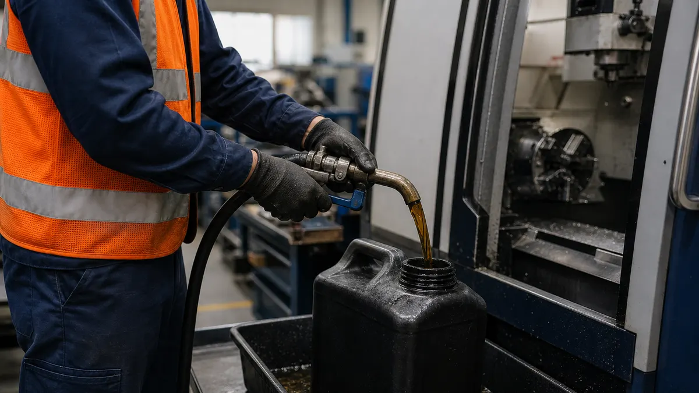

> **Key Takeaways**
> - ISO 14001:2026 certification for Ontario manufacturers rests on knowing which parts of the operation touch the environment and which laws apply to them. Everything else in the system builds on that.
> - The aspects register and the legal obligations register may receive close attention during an audit, so build them early and keep them current.
> - Objectives and operational controls must connect to real activities such as waste handling, emissions, chemical storage and energy use, not to general statements.
> - Stage 1 reviews the documented system and readiness; Stage 2 checks that people on the floor actually follow it.
> - Certification is the start of a three-year cycle. Surveillance audits, internal audits and management review keep it alive.

**Illustrative example:** An Ontario plant seeking ISO 14001 certification may be responding to a customer questionnaire that asks about environmental management, a tender that requires a certified system, or a regulator visit that exposed weak records. Whatever the trigger, the question for an environmental manager is the same: what does a registrar expect to see, and how much of it already exists on the shop floor?

The current edition is ISO 14001:2026, published on 15 April 2026. Many certified organizations still hold certificates to the 2015 edition, which remain valid during a 36-month transition ending in 2029. This guide describes the requirements in plain words, and where a clause number appears, it refers to ISO 14001:2015. [ISO's own explanation of ISO 14001](https://www.iso.org/home/insights-news/resources/iso-14001-explained.html) is a good starting point for the purpose of the standard.

## What ISO 14001 Certification Means for Ontario Manufacturers

ISO 14001 is a management system standard. It does not set emission limits or tell a plant which equipment to buy. It requires an organization to understand its environmental impacts, meet its legal obligations, set objectives it can measure and improve over time. A registrar then audits whether that system exists and works.

That distinction matters in a province with strict environmental rules. A plant can hold every approval it needs and still fail an ISO 14001 audit if nobody can show how the plant decides what to monitor, who is responsible, and what happens when a result drifts. The reverse is also true: a tidy system does not excuse a missing approval.

Plants that already run a quality system often find that document control, internal audits and corrective action carry over with little change. The [ISO 14001 Environmental Management service page](/services/iso-14001) outlines how those shared parts are reused rather than rebuilt.

## How to Assess Environmental Aspects, Impacts, and Legal Obligations

The first working task is identifying environmental aspects: the activities, products and services of the plant that can interact with the environment. An impact is the change that results, good or bad. Painting produces solvent emissions, machining produces used coolant and chips, and a forklift charging area produces battery acid risk.

Walk the plant, department by department, and record each activity under normal, abnormal and emergency conditions. A spill during a bulk delivery is an emergency condition; a furnace running at reduced load is abnormal. Then rate each aspect against criteria the plant defines in writing, so that the same activity gets the same rating no matter who scores it.

A register that works in an audit tends to have these features:

- Each aspect names the specific activity and location, such as "parts washer in building two", rather than a general category.
- The significance criteria are written down and applied the same way each time, so an auditor can follow the reasoning.
- Significant aspects point to the controls, objectives or monitoring that address them.
- The register is reviewed when processes, materials or equipment change, and the review date is visible.

### Legal and other obligations

The second register covers compliance obligations. For an Ontario manufacturer, this normally starts with the provincial [Environmental Protection Act](https://www.ontario.ca/laws/statute/90e19) and its regulations, then adds the approvals specific to the site. Plants that discharge to air, sewer or water, or that generate and ship waste, should confirm which approvals apply, and the province explains the process for [environmental compliance approvals](https://www.ontario.ca/page/environmental-compliance-approval) on its website.

For each obligation, the register should show what the requirement is, which activity it applies to, who owns it and how the plant knows it is being met.

> **Important:** ISO 14001 requires the organization to evaluate compliance with its obligations. An auditor who finds a legal breach that the plant never identified will usually raise a nonconformity, even if the paperwork elsewhere is excellent.

## How to Build Environmental Objectives and Operational Controls

Once significant aspects and obligations are known, the plant plans what to do about them. Clause 6.2 of ISO 14001:2015 asks for environmental objectives at relevant functions and levels, consistent with the policy, and, where practicable, measurable. Clause 8.1 asks for operational controls so that processes run as planned.

Good objectives come straight from the registers.

**Illustrative example:** A plant with a significant aspect in coolant disposal might set an objective to extend sump life through better filtration and tracking.

**Illustrative example:** A plant with a compliance obligation for air emissions might set an objective around maintenance of capture equipment.

Each objective needs an owner, resources, a deadline and a way to evaluate results.

**Operational controls are the instructions, limits and checks that keep a significant aspect from becoming an incident.** They include:

- Work instructions for chemical mixing, transfer and storage, with the container labeling and containment rules operators actually use.
- Waste segregation practices at each station, including labeled containers and a defined pickup schedule.
- Preventive maintenance on equipment with an environmental effect, such as scrubbers, filters and oil separators.
- Contractor and supplier requirements, so that outside waste haulers and service providers meet the plant's expectations.

> **Key Consideration:** Controls that depend on memory fail during staff changes. Put the control where the work happens, such as a posted limit at the tank or a checklist at the loading dock, and teach the reason behind it.

Plants that want to compare their current practice with the standard before investing in the full system can use the [free ISO readiness assessment](/assessment) to see where the larger gaps sit.

## How to Prepare Employees and Records for Certification Audits

An auditor learns more from a conversation with an operator than from any procedure. Competence, awareness and communication are therefore audited on the floor. Anyone working under the plant's control should know the environmental policy, the significant aspects of their own work and what a departure from the controls could cause.

> **Did You Know?** ISO 14001 does not prescribe a fixed list of procedures. It requires documented information that the organization determines is necessary for an effective system, plus the records the standard itself names.

Records are the proof that the system operates. Before the audit, check that these exist and are current:

- The environmental policy, scope statement and the roles and responsibilities assigned to staff.
- The aspects register and the compliance obligations register, with review dates and evidence of compliance evaluation.
- Monitoring and measurement results, with calibration records for the instruments that produce them.
- Internal audit reports, corrective actions and the minutes of a management review.

Document control deserves special attention because auditors often find an outdated procedure at the point of use. Keeping controlled documents, training records and audit findings in one place reduces that risk, which is the kind of work the compliance management software's [Documents module](/solutions/document-control/) is built to support.

A full internal audit and a management review must happen before the certification audit, and the plant should keep the outputs. Many registrars will ask to see both at Stage 1.

## What to Expect During Stage 1 and Stage 2 Audits

The certification audit has two stages, and a plant that understands the purpose of each can prepare to the right level.

**Stage 1 is a readiness review.** The auditor reads the system documentation, confirms the scope, reviews the registers and the results of the internal audit and management review, and talks with the environmental manager about how the plant understands its significant aspects and obligations. The auditor may walk the site to check that the described activities match reality. The output is a report that lists any areas of concern that could become nonconformities in Stage 2.

**Stage 2 is the implementation audit.** The auditor visits the plant, often for several days depending on size and complexity, and tests the system against the standard through interviews, observation and record sampling. Expect the auditor to follow a significant aspect from the register to the control, the monitoring record and the person who performs the task.

Findings are typically graded as major or minor nonconformities, or as opportunities for improvement. A minor finding needs a corrective action plan, while a major finding generally has to be closed before the certificate can be recommended. The registrar's certification decision follows a technical review, and it is made independently from the audit team.

## How to Maintain Certification and Improve Environmental Performance

A certificate is normally valid for three years, with surveillance audits in between. The registrar samples parts of the system each visit, and the full system is reassessed at recertification. Plants that treat the months after Stage 2 as a rest period often struggle at the first surveillance visit, because registers have gone stale and corrective actions have slipped.

A steady routine keeps the system healthy:

- Review the aspects and obligations registers whenever a new material, process or approval enters the plant, and at least on a planned schedule.
- Run internal audits across the year so that each area is checked, and follow every finding through to a verified fix.
- Track the objectives monthly and report progress to management, rather than waiting for the annual review.
- Hold the management review with real data on monitoring results, compliance status, incidents and resource needs, and record the decisions made.

Continual improvement is a requirement, but it does not demand dramatic projects. Small, documented gains in waste reduction, energy use or spill prevention satisfy the intent when the plant can show how they came from its own data.

## Frequently Asked Questions

### How long does ISO 14001 certification take for a manufacturer?

The timeline depends on the size of the plant, the number of processes and how much of the system already exists. A common estimate is six to twelve months from kickoff to the certification decision, with the registers and internal audit taking the most effort. Plants with an existing quality system often move toward the shorter end of that range.

### Does an Ontario manufacturer need to meet specific environmental laws before certification?

ISO 14001 requires an organization to commit to fulfilling its compliance obligations and to evaluate whether it does. A plant should not enter the audit with known, unresolved breaches. If a gap is found during preparation, record it, correct it and show the corrective action, because an auditor will test how the plant handles non-compliance.

### What documents should a manufacturer prepare for an ISO 14001 audit?

Prepare the policy, the scope, the aspects register, the compliance obligations register, objectives and plans, operational control procedures, monitoring records, training records, internal audit results and the management review record. The exact set depends on the plant, so confirm expectations with the chosen registrar.

### How often does a certified manufacturer need an external audit?

A certified plant is generally audited by the registrar once a year through surveillance audits, then fully reassessed at recertification at the end of the three-year cycle. The registrar can schedule additional visits if there are serious concerns or major changes to the operation.

### Can a small manufacturer implement ISO 14001 without a full-time environmental manager?

Yes. Many smaller shops assign the role to a quality manager, an operations lead or a health and safety coordinator, with outside support for the first cycle. What matters is that the person has time, authority and top management backing, and that responsibilities for each control are shared with supervisors.

Keeping the registers, training records, internal audits and corrective actions current by hand is the part of an environmental management system that slips once the certificate is on the wall. Compliance management software can keep those records connected in one place, and you can [book a demo](/contact/) to see how it would fit your plant.
