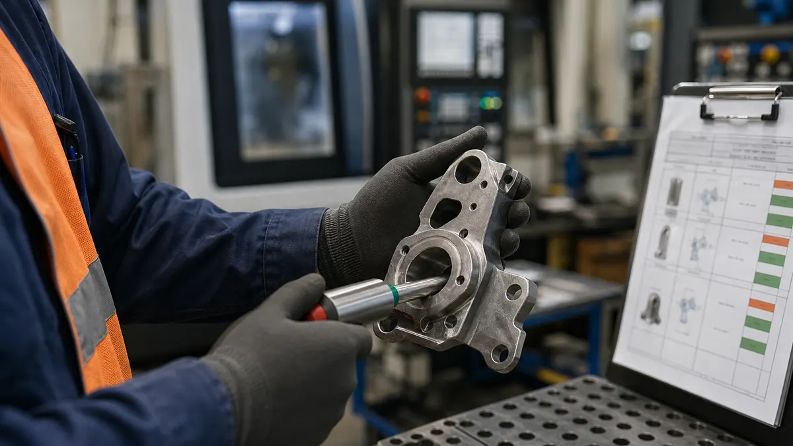
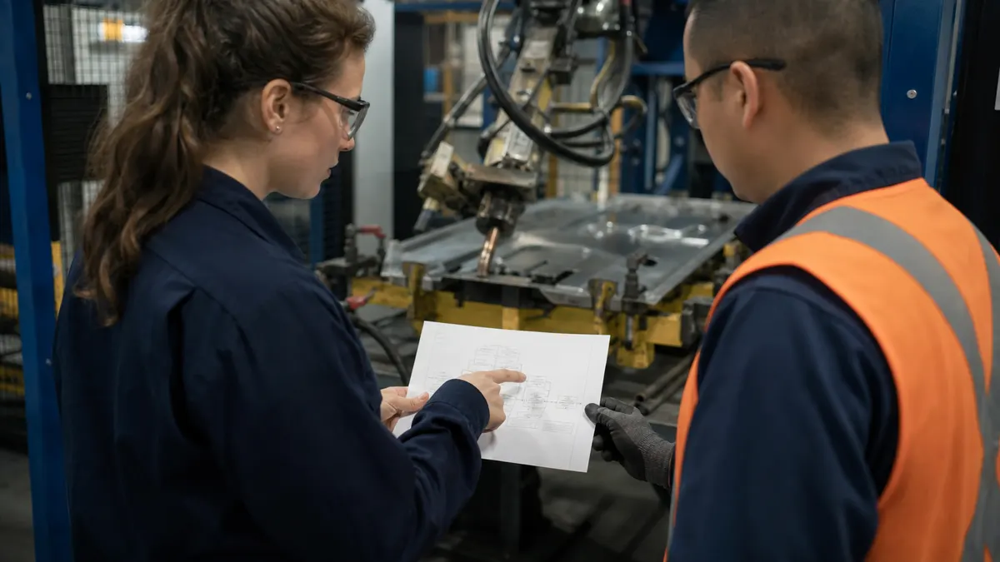

> **Key Takeaways**
>
> - A control plan is the written summary of how a supplier keeps a product and its process under control, from receiving through shipping, and IATF 16949:2016 requires one for the products it supplies.
> - The plan must stay linked to the process flow and the PFMEA, so a change in one is checked against the other two.
> - Special characteristics, whether set by the customer or identified by the supplier, need visible treatment and stronger controls in the plan.
> - Plans must be reviewed and updated after process changes, shipped nonconforming product and changes to the risk analysis.
> - Auditors look for evidence that the plan is used on the floor, not only that it exists.

A control plan that sits in a binder and never gets opened on the line is one of the quickest ways for an automotive supplier to earn a finding. The IATF 16949 control plan requirements ask for something more demanding than a form: a living document that tells an operator what to check, how often, with which gauge, and what to do when the result is wrong. This article explains what the standard expects, how the pieces connect, and how Ontario plants keep their plans credible.

## Why Control Plans Matter in the Automotive Supply Chain

Automotive customers buy parts in large volumes on tight schedules, and a drifting process can put a substantial volume of nonconforming parts into a customer's assembly plant before anyone notices. The control plan is the supplier's written answer to that risk. It shows the customer, and the certification body, where the process can go wrong and what stops it from going wrong.

For a Tier 2 or Tier 3 supplier in Ontario, the plan is also a communication tool. Customers review plans during launch and expect to see their drawings, their special characteristics and their own requirements reflected in it. A plan that ignores those inputs signals that the supplier has not read the customer's requirements closely.

The requirement sits within the wider set of automotive core tools. The [Automotive Industry Action Group (AIAG)](https://www.aiag.org/) publishes reference manuals for planning, FMEA, measurement systems and statistical process control, and the control plan is the document where those tools meet. Shops moving from ISO 9001:2026 to automotive work often find this is the biggest practical jump, although many certified organizations remain on the 2015 edition during the transition. The [comparison of IATF 16949 and ISO 9001 for Ontario manufacturers](/blog/iatf-16949-vs-iso-9001-key-differences-for-ontario-manufacturers) covers the wider differences.

## What IATF 16949 Expects a Control Plan to Document

Clause 8.5.1.1 of IATF 16949:2016 requires the organization to develop control plans at the system, subsystem, component or material level for the product supplied. That includes plans for processes producing bulk material as well as parts. The standard also expects plans to cover the pre-launch and production phases, and a prototype phase when the customer requires one.

In practice, the control plan lists the information an operator, inspector or auditor needs to see the control at each step. The standard asks for the following content, described here in plain terms:

- **The controls used for process control**, including the checks done on the product, the process parameters and the verification of job setups. Each step in the process flow should show what is controlled and how.
- **The methods for monitoring control of special characteristics**, so the reader can tell at a glance which characteristics need extra attention and which technique watches them.
- **Customer-required information**, including any approval or data the customer asks to see, so the plan matches the customer-specific requirements on file.
- **The reaction plan**, which states what happens when the process is not capable or becomes unstable, and which includes containment of suspect product.

Each of those has to be usable by the person doing the work. A reaction plan that says "notify the supervisor" tells the operator very little. A reaction plan that names the stop condition, the containment step and who decides on disposition gives the operator a path to follow.

> **Important:** Clause 8.5.1.1 of IATF 16949:2016 expects the control plan to be consistent with the process flow diagram and the PFMEA. A plan that was written once and never compared to either document will be hard to defend at audit.

### Pre-launch and production plans

The pre-launch plan covers the checks and measurements applied after prototype and before full production. It often has more frequent sampling and extra dimensional or functional checks, because the process is still being proven. The production plan documents the controls for steady-state running. The two should not be the same document with the title changed, and customers often review the pre-launch plan before they approve the launch.

**Illustrative example:** A stamping plant in Windsor is launching a new bracket for a Tier 1 customer. The pre-launch plan calls for first-piece inspection on every die setup plus an extra check on a hole position that the customer flagged during review. Once the process has shown it is stable, the production plan keeps the setup check but moves the hole position to the sampling frequency and gauge the customer approved.

## Connecting Process Flow, PFMEA and Control Plans

The three documents describe the same process from different angles. The process flow diagram lists the steps. The process failure mode and effects analysis (PFMEA) lists how each step can fail and what the effect would be. The control plan lists what the supplier does to prevent or detect those failures.

When the documents are aligned, a reader can pick any high-risk failure mode in the PFMEA and find the corresponding control in the plan. Going the other way, every control in the plan should trace to a reason in the PFMEA or a requirement from the customer. A control with no stated reason tends to be dropped quietly when the line is busy.

Many plants find alignment slips at the process-change stage. A supplier adds a deburring step or moves an inspection upstream, updates the flow diagram, and forgets that the PFMEA and the plan both need the same revision. The result is three documents that disagree, which an auditor following one part through the plant will see quickly.

A practical habit is to keep the three documents in one controlled revision set, so a change request prompts review of all of them. The approach also fits the document control practices described in the [guide to building an ISO 9001 document control procedure](/blog/how-to-create-an-iso-9001-document-control-procedure-in-6-steps).

### Using measurement and monitoring methods that fit the characteristic

The plan should name the evaluation or measurement technique, not only the characteristic. A critical diameter checked with a calibrated micrometer at a stated frequency is a control. "Check diameter" is not. The IATF standard also expects measurement system analysis and statistical studies for the gauges and methods named in the plan, so the gauge in the plan must be one the plant has actually studied.

## Managing Special Characteristics and Customer-Specific Requirements

Special characteristics are product or process characteristics that carry extra weight because they affect safety, regulatory compliance, fit, function or later processing. Clause 8.3.3.3 of IATF 16949:2016 asks the organization to use a multidisciplinary approach to identify them, and to include customer-designated characteristics and the supplier's own. Customers often use their own symbols, so the supplier must follow the customer's notation, or the supplier's own defined symbols, consistently across drawings, the PFMEA and the plan.

Once identified, a special characteristic needs to show up everywhere it matters. That means the drawing, the PFMEA, the control plan, the work instruction and the operator's inspection record. If the symbol appears in the plan but not on the work instruction, the operator may not know the characteristic matters.

> **Key Consideration:** Keep a short list of every customer that applies its own symbols or its own control plan format, and check it each time a drawing revision arrives. Customer-specific requirements change the plan as directly as an internal process change does.

Customer-specific requirements can also change the plan template itself, the review frequency, the approval path or the evidence the customer expects at launch. Suppliers serving several customers often discover the same part number needs a slightly different plan for each. The [IATF 16949 automotive quality service page](/services/iatf-16949) explains how the standard and customer requirements fit together for suppliers working toward certification.

## Updating Plans After Process Changes or Nonconformities

A control plan is only useful while it reflects reality. IATF 16949:2016 expects the plan to be reviewed and updated when certain events occur, and the events are worth building into the plant's change procedure:

- **A nonconforming product is shipped to a customer.** The plan should be reviewed to see why the existing controls failed to catch it, and updated if they were inadequate.
- **A change affects the product, the manufacturing process, measurement, logistics, supply sources or production volume.** Even a modest change can alter the risk of a process step.
- **The PFMEA changes.** New or revised risk ratings may call for different controls or different frequencies.
- **The customer requires it.** Some customers request a review at set intervals or at specific milestones.

Beyond those triggers, the standard also expects review at a frequency the organization defines. The right frequency depends on the stability of the process and the customer's own demands, and the plant should be able to explain why it picked its interval.

**Illustrative example:** A machine shop in Kitchener has a customer complaint about a burr on a hydraulic fitting. The corrective action finds the final inspection plan relied on visual checks that did not cover the cross-drilled hole. The team adds a specific inspection step to the control plan, updates the PFMEA detection rating, and records the revision with the date and the approval. Without the plan revision, the corrective action would have closed on paper while the same gap stayed open.

### Who approves the change

Approval should follow the same path as other controlled documents. A cross-functional team, usually quality, manufacturing and engineering, reviews the change, and the customer approves where its requirements say so. The plant should record who approved the change and when, because auditors often ask for that trail.

## Preparing Control Plans for Customer and Certification Audits

Certification bodies audit the control plan as part of the process approach, and customers may review it during launch and supplier audits. Both want to see that the plan is in use. The auditor often picks a part, finds the plan, goes to the line and checks that the operator is doing what the plan says.

Evidence that tends to satisfy an auditor includes:

- **Records that match the plan.** If the plan calls for a check every hour, the records should show hourly checks, with clear actions when a result is out of tolerance.
- **Gauges and measurement methods that match the plan.** The gauge on the line should be the gauge named in the plan, and it should be in calibration.
- **Reaction plans that were actually used.** Records of a stopped line, contained product or an escalated deviation show the reaction plan works in practice.
- **Revision history linked to events.** Changes should connect to a customer notice, a process change or a corrective action.

The manufacturing process audit requirements in IATF 16949:2016 also reach the control plan, since process audits check that controls are applied as written. The [IATF Global Oversight](https://www.iatfglobaloversight.org/) website publishes the certification rules and sanctioned interpretations that certification bodies follow, which helps plants understand how audits are run.

Practicing the walk before the audit helps. A quality manager can pick two or three parts, follow each from receiving to shipping, and compare what the plan says with what operators do. The gaps this exposes are usually small and fixable: a gauge that was replaced, a frequency nobody updated, a reaction plan the shift has never seen.

Suppliers starting from a lower base can use the [free ISO readiness assessment](/assessment) to see where documents and records stand before booking a registrar, and the [Automotive industry page](/industries/automotive) describes how ISO Certification Consultants supports automotive suppliers.

## Frequently Asked Questions

### What information must an IATF 16949 control plan include?

The plan must show the controls used to manage the process, the methods for monitoring special characteristics, any information the customer requires, and a reaction plan for when the process is unstable or not capable. It must also be consistent with the process flow and the PFMEA.

### Does every manufacturing process need a control plan?

Clause 8.5.1.1 of IATF 16949:2016 requires control plans for the product supplied, at the system, subsystem, component or material level, covering the pre-launch and production phases. A family plan is possible where the standard and the customer allow it, but the supplier needs to be able to show it covers each product and process in it.

### How often should an automotive supplier review its control plans?

The standard sets triggers: shipped nonconforming product, process or product changes, PFMEA changes and customer requirements. It also expects reviews at a frequency the organization defines, and the plant should be able to explain the basis for that frequency.

### Who is responsible for approving control plan changes?

A cross-functional team normally reviews and approves the change, with the customer's approval where its requirements call for it. The plant's own document control procedure should name the approvers and keep the record.

### What evidence do auditors look for when reviewing a control plan?

Auditors look for records that match the plan, gauges that match the plan, a reaction plan that has been used, and a revision history tied to real events. They also compare what operators do on the floor with what the plan says.

Keeping control plans, PFMEAs, revisions and approvals in step across shifts and customers is the part that slips when it relies on spreadsheets and shared folders. ISO Certification Consultants' compliance management software keeps those records in one controlled place, and you can [book a demo](/contact/) to see how it handles revisions and approvals.
