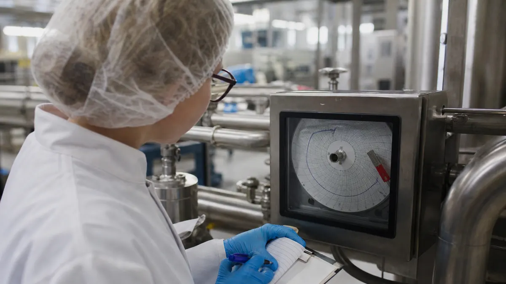
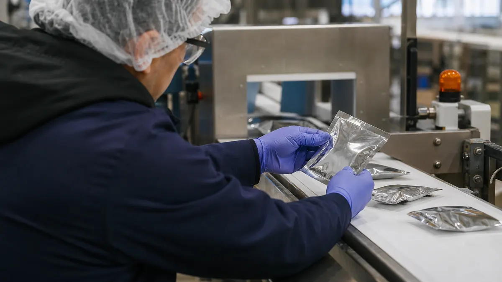

> **Key Takeaways**
>
> - ISO 22000:2018 is a management system standard for food safety, so certification rests on a defined scope, a documented hazard analysis and records that prove the controls run every day.
> - Prerequisite programs such as sanitation, pest control and supplier approval are a formal requirement, and the hazard analysis depends on them being in place first.
> - The standard sets a recognizable structure for hazard control, including operational prerequisite programs and critical control points, that auditors follow step by step.
> - Internal audits and a management review must happen before the certification audit, because the certification body expects to see a system that already checks itself.

Why does a plant with a spotless floor and a clean inspection history still stumble on its first certification audit? Usually because ISO 22000 certification for Ontario food manufacturers is judged on the management system behind the floor, not on how the floor looks on audit day. The standard asks whether hazards are identified, controls are chosen for stated reasons, monitoring is recorded and the whole arrangement is reviewed by people with authority to change it.

This article walks through what the current edition, ISO 22000:2018, expects of a food plant, in the order a quality manager would meet it. It covers scope, hazard analysis, prerequisite programs, audit preparation and the work that follows certification.

## Why ISO 22000 Matters to Ontario Food Manufacturers

Food plants answer to several audiences at once. Regulators expect safe product, retail and brand-owner customers send supplier questionnaires, and export buyers ask for a certificate from an accredited body. A single management system that serves all of them is easier to run than three separate sets of paperwork.

The official page for [ISO 22000:2018 on iso.org](https://www.iso.org/standard/65464.html) describes the standard as the requirements for a food safety management system for any organization in the food chain. That covers primary processors, bakeries, sauce and beverage plants, co-packers and packaging suppliers. No newer edition has been published; Amendment 1:2024 applies to the 2018 text, and a revision is still in draft.

Some customers ask for more than ISO 22000 alone. A retailer may name a benchmarked scheme such as FSSC 22000 Version 7, which builds on ISO 22000 and adds scheme rules. The article on [FSSC 22000 certification requirements in Canada](/blog/fssc-22000-certification-requirements-in-canada-10-checks-for-food-manufacturers) explains that next step, and the work done for ISO 22000 carries over into it.

## Defining the Scope of a Food Safety Management System

Clause 4.3 of ISO 22000:2018 requires the organization to define the boundaries of its food safety management system. The scope states which products, processes and sites are covered, and it must be available as documented information. An auditor reads it first, because every later question is measured against it.

A tight, honest scope saves time. **Illustrative example:** A plant that makes baked goods on two lines and also runs a separate seasonal packing room needs to decide whether the packing room is in or out, and write that down with the reason.

### What the scope should state

A workable scope statement is short and specific. It usually covers the following:

- **Products and product groups** made at the site, described the way the plant describes them to customers, so the auditor can match them to the production schedule.
- **Processes and activities** included, such as receiving, storage, mixing, cooking, filling, packing and shipping, plus any outsourced steps that affect safety.
- **Locations and boundaries**, including warehouses or contract storage that handle product before it reaches the customer.
- **Exclusions with a reason**, because anything left out must not affect the plant's ability to deliver safe product.

The standard also expects the plant to understand the parties that matter to food safety and what they require. Customers, regulators, suppliers and certification bodies all belong in that list, and a short register of their requirements is enough to start.

> **Important:** Top management must show leadership of the system, including setting a food safety policy and assigning a food safety team leader. A system run only by the quality department, without visible backing from management, is a common reason an audit slows down.

## Applying Hazard Analysis to Food Production

Hazard analysis is the center of the standard. Clause 8.5 of ISO 22000:2018 sets out the steps: gather preliminary information about products and ingredients, build flow diagrams, then identify biological, chemical and physical hazards at each step. Allergens belong in the chemical group, and the plant decides acceptable levels for each hazard in its end product.

The question the plant must answer for each significant hazard is how it will be controlled. ISO 22000 uses the same hazard analysis logic as HACCP, which answers a frequent question from plant managers. If a site already runs a HACCP plan, much of the technical work exists, though the management system structure around it still has to be added.

### Control measures and how they are chosen

Once hazards are assessed, the plant selects control measures and sorts them into two categories. **Operational prerequisite programs** manage a hazard through a measure specific to the process, with action criteria and monitoring. **Critical control points** are measures where a limit must be met and a loss of control calls for immediate correction.

For each control point, the hazard control plan records the hazard, the critical limit or action criterion, the monitoring method, the frequency, the person responsible and the correction when limits are missed. Auditors often pick one control point and follow its records from the plan to the floor to the signed monitoring sheet.

**Illustrative example:** A bakery with a cooling tunnel and a metal detector might treat the metal detector as a critical control point for foreign matter, with a set of test pieces checked at the start of each shift. If a test piece is missed, the plan states what happens to product made since the last good check. The records then show a pattern that supervisors can review rather than a stack of unexplained initials.

## Building Prerequisite Programs for Plant Operations

Clause 8.2 of ISO 22000:2018 requires prerequisite programs that keep the production environment suitable for safe food. They are the basic conditions, and the hazard analysis assumes they are working. For many plants this is where the most existing work sits, but it is also where records quietly go missing.

Typical programs include the following:

- **Sanitation and cleaning verification**, with schedules, chemical concentrations and swab or visual checks that show the cleaning worked.
- **Pest control**, with a service agreement, a site map of devices and trend reviews rather than only visit reports.
- **Supplier approval and incoming material checks**, so ingredients and packaging arrive with the specifications the hazard analysis expects.
- **Personnel hygiene and training**, including who may enter the production area and what they must wear.
- **Maintenance, calibration and glass or hard plastic control**, which keep equipment from becoming a hazard source.

Does a food plant need these in place before certification? In practice, yes. The certification body will test the programs during the audit, and a hazard analysis that relies on a program that does not run will not hold up. Ontario plants also operate under federal and provincial food rules, and the prerequisite programs are a sensible place to line those duties up with the management system.

> **Did You Know?** ISO 22000:2018 requires a traceability system and emergency preparedness procedures in addition to the hazard control steps, so a plant should be ready to show how it would trace a lot and how it would handle a recall.

## Preparing for Certification Audits

A food plant does not start with the certification body. Start with the plant's own checks. Clause 9.2 of ISO 22000:2018 requires internal audits at planned intervals, and clause 9.3 requires a management review. Both should be completed, with findings addressed, before the certification audit begins.

Many plants find it useful to begin with a short gap review against the standard. The [free ISO readiness assessment](/assessment) is one way to see where the system stands before spending time on internal audit scheduling.

### The stages of the audit itself

Certification audits usually run in two stages. The first reviews the documented system, the scope and the plant's readiness. The second visits the floor, follows product and records, and confirms that the system works in practice. Findings are graded, and the plant must respond to nonconformities with corrections and corrective actions before a certificate is recommended.

Choosing the certification body matters as well. The Standards Council of Canada explains [how accreditation of certification bodies works in Canada](https://scc-ccn.ca/accreditation/about-accreditation), which helps a buyer check that the body issuing the certificate is accredited for food safety work.

**Illustrative example:** A sauce manufacturer finishes its internal audit and finds that cleaning verification records exist for the filler but not for the shared mixing tanks. It adds the missing checks, trains the sanitation crew and records the correction before the first audit stage. The certification auditor then finds the gap already closed and documented, which reads better than a gap discovered on the day.

The time needed varies with the plant's starting point. A site with an existing HACCP plan and disciplined records typically needs several months. A plant building prerequisite programs and a management system together typically needs longer, and the right estimate comes from a scoped review of the site.

## Maintaining and Improving Food Safety Controls

Certification is the start of the work, not the end. Accredited certificates are subject to surveillance and recertification audits on schedules set by the certification body. Between audits, the system has to keep running on its own evidence.

Several habits keep a certified plant steady:

- **Verification activities**, such as reviewing monitoring records, testing finished product and checking that control measures still work as planned.
- **Updating the hazard analysis** when ingredients, equipment, recipes or suppliers change, so the plan reflects what the plant actually makes.
- **Corrective action that addresses causes**, with a record of what was changed and a follow-up check that it worked.
- **A real management review** where results, audit findings, complaints and changes feed decisions about resources.

> **Key Consideration:** Treat every new product, line change or supplier switch as a trigger to revisit the hazard analysis. The plants that struggle at surveillance audits are often the ones whose plan describes last year's process.

A certificate also needs to be checkable by customers. The [IAF CertSearch](https://www.iafcertsearch.org/) database lets buyers confirm that an accredited management system certificate is valid, so a plant can expect its own status to be looked up.

For a wider view of how the standard fits with a plant's other programs, see the pages on [ISO 22000 food safety](/services/iso-22000) and the [Food & Beverage industry](/industries/food-beverage).

## Frequently Asked Questions

### What does ISO 22000 certification require of a food manufacturer?

A food manufacturer must define the scope of its food safety management system, set a food safety policy under top management, run prerequisite programs, complete a hazard analysis and hazard control plan, and keep records that show the controls operate. It must also run internal audits and a management review, then pass an audit by an accredited certification body.

### How long does ISO 22000 certification take for an Ontario food manufacturer?

The timeline depends on what already exists. A plant with a working HACCP plan and solid records typically takes several months, while a plant building its programs and management system together typically takes longer. A scoped review of the site gives a more reliable estimate than any general range.

### Does a food plant need prerequisite programs before ISO 22000 certification?

Yes. Clause 8.2 of ISO 22000:2018 requires them, and the hazard analysis relies on them. The certification body will check that the programs are defined, applied and verified, so they should be running well before the audit.

### How does ISO 22000 address hazard analysis and critical control points?

The standard follows the same logic as HACCP. The plant identifies hazards, evaluates them, and selects control measures, which become either operational prerequisite programs or critical control points. The hazard control plan records limits, monitoring, responsibilities and corrections for each one.

### How often does an ISO 22000-certified food manufacturer need an audit?

Accredited certification schedules include surveillance audits between certification and recertification, with the certification body setting the exact timing. Internal audits are separate and must be planned at intervals the plant defines, based on risk and past results.

Keeping hazard analyzes, monitoring records, internal audit findings and corrective actions current by hand is where food safety systems tend to slip between audits. ISO Certification Consultants' compliance management software keeps those records in one place so changes are traceable, and you can [book a demo](/contact/) to see how it would fit a food plant.
